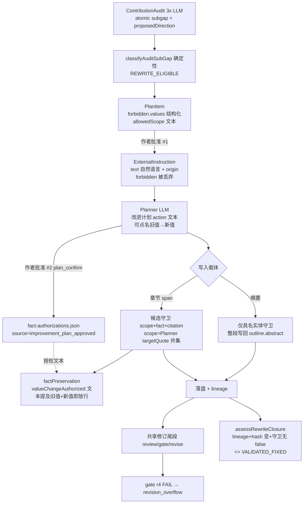
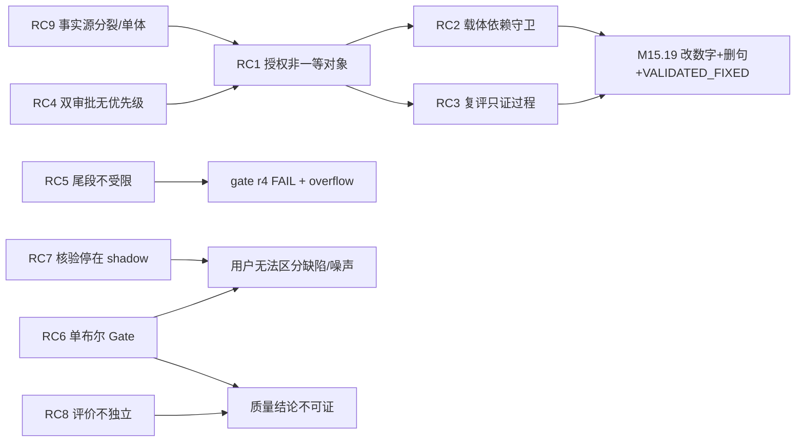
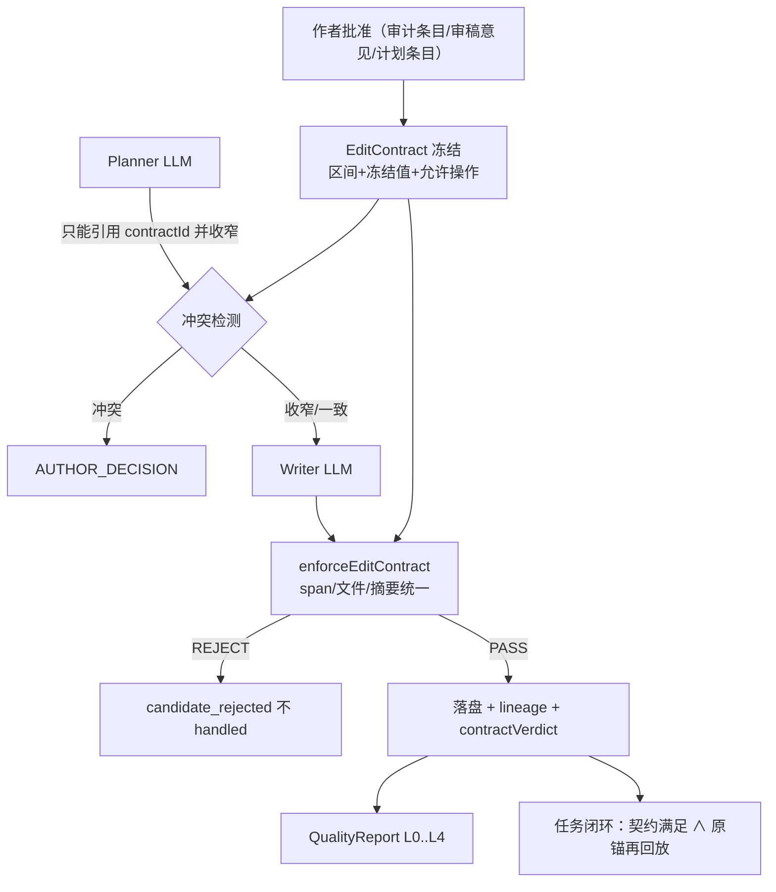

# M15 Quality Gate：原始目标回溯与架构适配性独立审计

- 日期：2026-11-01 · 性质：**静态审计**（零源码 / 测试 / Prompt / 配置 / 数据改动；零模型调用；未运行任何测试、工作流或脚本）
- 起点：`D:\Projects\PaperTeam` `main` == `origin/main` == `7a277577608b2a16be7d5f871358e1ea0bb9f5d3`，工作区 clean（审计开始时 `git status --short --branch` 核对）
- 证据等级标注：**[源码]** 静态源码证实（路径:行号，均为 7a27757）· **[冻结结果]** 已冻结真实运行工件支持（`D:\PaperTeamData\...`，仓库外只读）· **[报告声称]** 历史报告文字，未逐项复核 · **[推断]** 待验证推断
- 原始目标来源：用户本机 `Downloads\PaperTeam_M15_Quality_Gate_Handover.md`（2026-10-21，下称「交接文档」）与 `Downloads\PaperTeam_M15_Quality_Review_Revision_Roadmap_and_M15_1_Claude_Task.md`（2026-10-22，下称「路线文档」）。两者不在仓库内，本报告只引用其条款，不复制。

---

## 1. 执行摘要（第一屏）

| # | 结论 | 置信度 |
|---|---|---|
| 1 | **架构存在系统性问题，但不在「Runtime / 三路 Reviewer / 确定性 Gate」这个宏观分层上，而在三条边界上**：① **编辑授权不是一等公民对象**——约束以自然语言散落在指令文本 / Prompt 中，LLM Planner 的计划文本经 plan_confirm 后直接成为事实守卫的授权来源，且守卫强度随写入载体（摘要 vs 章节 span）不同；② **一个布尔 `gate.passed` 混合了确定性完整性检查与 LLM 判断计数**，周围又长出 9 个互可矛盾的「结论」概念；③ **评价不独立**——写者、审者、裁判同一模型族，人类独立标签为 0。M15.19 的「改数字 + 越界删句 + VALIDATED_FIXED」不是一次偶然遗漏，是 ① 的必然产物。 | 高（①②源码证实；③数据证实） |
| 2 | **现有功能距离最初目标：工程完整性维度接近，科学质量维度未被证成，目标期刊维度在当前约束下不可证。** Completeness = ENGINEERING_VALIDATED（覆盖账本、required NOT_EVALUATED 不放行）；Correctness = 仅「摘要/结论 ↔ 表格数值」与作者登记复算进入生产，长文档作者稿 claim 级核验**不在生产 Gate**；Severity = 生产路径仍是 **LLM 原始 critical/major 计数**，M15.2 的核验 / 裁决全部 shadow；Calibration = 80 分被「诚实降级」为 advisory 而**非校准**，且仍通过 `academic_non_regression` 硬阻断泄漏；Revision Closure = **不可信**（E1）；Target Journal = **INCOMPLETE 且在「零人工标签」约束下结构性不可证**。 | 高 |
| 3 | **M15 一直不能收敛的主因不是「修得不够」，而是优化对象错位**：19 个子阶段约 +22.9k 行 `backend/src`（99 个提交），其中 M15.1–M15.4 的科学核验能力几乎全停在 shadow / flag-off，从未改变生产严重度路径；M15.8.x 在**系统自己生成的综述**上用 27 轮把内部 Gate 刷到 PASS（含「披露口径」引导分类器的 Goodhart 成分）后被撤回；M15.17–19 的 10 个闭环提交全部在修锚定 / 投影 / 分类 / lineage，**没有一个提交把已存在的结构化禁改字段 `forbidden.values` 接到执行或判定**。 | 高 |
| 4 | **推荐路线 B：「授权内核 + 分层 Gate + 诚实产品口径」**——保留 Runtime / Reviewer / 守卫 / 覆盖账本 / 复算 / 证书器等资产；新增一个确定性 `EditContract`（作者批准时冻结的允许区间 + 冻结值多重集 + 允许操作），所有写入路径（span / 整文件 / 摘要）统一经同一 diff 校验器；LLM 文本永不作为授权来源；Gate 拆成 L0 完整性 / L1 已证实科学缺陷 / L2 AI 评议（advisory + 核验状态）/ L3 任务闭环 / L4 目标期刊（明确 UNVALIDATED）。拒绝「继续局部修补（A）」与「核心质量决策层重写（C）」，理由见 §6。 | 中高 |
| 5 | **必须停止的投入**：① 以单篇真实论文跑通为驱动的「真实运行 → 发现局部缺陷 → 修补 → 新子阶段」循环；② 在已开封 SEALED 集上的证书器别名 / 短语微修（M15.3.x 型）；③ 以同模型 LLM 裁判的公开评审试点作为质量证明；④ 向 Prompt 继续追加约束文字；⑤ 在零人工标签约束下继续追求「目标期刊质量达标」裁决。 | 高 |
| 6 | **保留的资产**：覆盖账本与 required NOT_EVALUATED 语义；`claimChecks` 作者数据复算；`crossSectionConsistency` / `claimCertificate` 确定性数值绑定；Citation 静态 / 元数据核验；patch 候选管线中的 scope / fact / citation 守卫（在 span 路径上 E1 实际拦住了同一改数字）；修订 lineage 与 409 陈旧拒绝；TargetAuditRevisionService 的确定性五类分类（但需把输出接到授权内核）。 | 高 |
| 7 | **缺的证据**：任何独立于系统模型族的质量判断（人类或异族模型）；E1 中 plan_confirm 审批界面实际向审批者展示了什么（未追踪前端）；历史已接受 patch 在拟议 EditContract 下的误拒率（可零模型回放测得）。 | — |
| 8 | **下一步建议先做产品决策，再实施**：用户需在「(a) 接受目标期刊质量层永久标注 UNVALIDATED、产品承诺降为『可追溯的审稿 + 受控修改』」与「(b) 引入独立外部标签（人或异族模型 + 公开评审）」之间选择。P0（授权内核）不依赖此决策，可先行；P0 的验收可以完全零模型（回放 E1 / M15.18 冻结工件）。 | 高 |

**一句话**：我们一直在优化「让内部 Gate / 内部闭环指标变绿」，而原始目标要求的是「每个结论有可复核依据、每次修改有可证明授权、每个分数有外部意义」。前两项靠确定性工程即可证明、目前缺的是边界设计；第三项靠工程无法证明，必须产品分层承认。

---

## 2. 原始目标与现状对照矩阵

### 2.1 目标变更史（只列改变口径的节点）

| 时间 / 来源 | 目标表述 | 性质 |
|---|---|---|
| 交接文档 §2（2026-10-21） | 四问：Completeness / Correctness / Severity / Calibration；§3 M15.4 加真实返修闭环；§4「外部专家标签不足 → 只能宣称工程性验证通过 / 学术有效性暂未证实」；结果分四级 `ENGINEERING_GATE_VALIDATED / FINDING_QUALITY_VALIDATED / SCORE_CALIBRATED / END_TO_END_VALIDATED` | **原始目标** |
| 路线文档（2026-10-22） | 产品转向「已有论文改进 > 审稿意见返修 > Quick Review > 新论文生成（冻结）」；M15.1–M15.5 五段路线；「不引入专家人工标注」（M15.2 节）；目标期刊「未填时不得宣称达到具体期刊要求」 | 范围约束（首次出现「不引入人工标注」） |
| M15.7（`M15_7_...CLOSURE.md` 首段） | 80/35 从硬门「诚实降级」为 UNVALIDATED advisory | 口径调整（未校准，属降级非达成） |
| M15.8–M15.8.6 | 以 `topic_survey` 生成的综述跑通「真实 Gate PASS + Final PDF」作为收口；M15.8.6 宣布 `M15_COMPLETE` | **目标漂移**：验收对象从「用户已有稿件」变成「系统自生成稿」，违背路线文档优先级（`M15_8_REAL_PAPER_QUALITY_GATE_E2E_CLOSURE.md` 自述「本综述是系统验收工件，不是用户原创可投稿稿件」[报告声称]） |
| M15.9 开篇（`docs/PROJECT_STATUS.md:14`） | 撤回 COMPLETE；「M15 的最终验收定义回归用户原始目标：给定论文 + 指定目标期刊，可信判断是否达到该期刊所需学术水平」 | **目标升级**：交接文档并未把「期刊级水平判别」设为 M15 验收，只把它列为不得越界宣称的边界。此后 M15.9–M15.19 均以 `M15_TARGET_JOURNAL_QUALITY` 为总门 |
| M15.10 起 | 独立人类标签 = 0，`DATA_BLOCKED`；用户不要求人工标注 | 与 M15.9 升级后的目标**结构性冲突** |
| M15.17–M15.19 | 「审计缺口 → 受控改写 → VALIDATED_FIXED」闭环 | 回到交接文档 M15.4 的返修维度，但以审计子缺口为单位 |

**冲突声明（不悄悄改目标）**：M15.9 之后的「目标期刊质量达标」目标 + 「零人工标签」约束 = 该目标在定义上不可证。可选产品范围：
- **S1（推荐的诚实默认）**：承诺「可追溯审稿 + 受控修改 + 工程完整性」；目标期刊层永久标注 `UNVALIDATED_ADVISORY`，只做官方规范的可机检条款合规（M15.16 已有）。代价：不能宣称「达到某刊水平」。
- **S2**：引入独立外部校准（人类双盲标签，M15.10 已备好双盲包；或异族模型 + 公开评审作为弱代理）。代价：人力 / 费用；即使做了也只是统计意义上的「与外部判断一致率」，不是录用担保。
- **S3**：维持现目标但不提供标签——**不建议**，会无限产生 PARTIAL 子阶段。

### 2.2 六种结论的区分（产品与代码是否混淆）

| 结论 | 能否由确定性工程证明 | 当前代码 / UI 表现 |
|---|---|---|
| 修复任务成功（指定意见已按授权闭环） | **能**（若授权是结构化对象） | 当前**不能**：`assessRewriteClosure` 只证明「有 lineage + 哈希变了 + 守卫无 false」[源码 `backend/src/target/TargetAuditRevisionService.ts:953-1001`] |
| 工程 Quality Gate 规则可靠 | **能**（负例 / 不变量测试） | 基本成立（`Gates.test.ts:359-409` 断言 required NOT_EVALUATED → passed=false）[源码] |
| 论文内容质量高 | 只能统计性外部验证 | 无独立验证；但 `backend/src/review/revisionOutcome.ts:110` 在 gatePassed 时显示「质量验收通过，论文已冻结」[源码] → **混淆** |
| 达到目标期刊要求 | 可机检条款能；学术水平只能外部统计 | M15.16 合规机检为确定性；`TargetVerdict` 枚举值仍叫 `MEETS_TARGET`（仅显示标签软化）→ 轻度混淆 |
| 可投稿 | 不能由模型单独担保 | 前端 `frontend/src/components/common/status.ts:465` `READY: "投稿就绪"`；而 `TargetSubmissionReadinessService.ts:9-13` 声明永不输出 Publication Ready → **两套「可投稿」口径矛盾** |
| 可能录用 | 不能（无外部标签不可估计） | 代码未输出概率（守住了）；M15.19 报告明确不输出 [报告声称] |

### 2.3 目标达成度矩阵

| 原始维度 | 现有实现（生产路径） | 验证层级 | 剩余缺口 | 阻塞性 |
|---|---|---|---|---|
| Completeness | 覆盖账本 + `review_coverage_complete` required（`backend/src/quality/gates.ts:909-921`）；未审 / 缺依赖 → NOT_EVALUATED（`gates.ts:927-958`）；required NOT_EVALUATED 不放行（`gates.ts:580`） | **ENGINEERING_VALIDATED**（单测 + 历史真实运行） | shared_session 下跨单元核对不可复现（`gates.ts:933` 自述）；PDF 重建丢公式 / 表格（`backend/src/import/PaperReconstructor.ts:1-20`）；输入保真只读取证明不实算（`definitions.ts:101`） | 中 |
| Correctness | 生产：`cross_section_numeric_consistency`（`gates.ts:752-805`，确定性）、`experiment_claims_recomputed`（`gates.ts:713-749`，作者登记）、citation 静态 / 元数据；claim 级 grounding 仅 digest 模式 | 确定性部分 **静态链路完整 + 受限真实验证**；模型 finding 部分**无独立验证** | **长文档作者稿单元模式不产出 claims，规则 4 恒 NOT_EVALUATED**（`gates.ts:647-655`）；claimAudit 对作者稿是 shadow（`claimAuditMode.ts`）；citation 语义核验默认 off（`citation/semanticMode.ts:30`） | **高** |
| Severity | `open_critical_major_zero` = LLM 原始计数 − 三类确定性排除（`gates.ts:841-858`）；`severityRubric` 只注入已发表论文评估 | 未验证；M15 基线同稿 major 根因 Jaccard 0.406 [冻结结果 `QualityGateCalibration/analysis/stability_base.json`] | M15.2 findingVerification / findingAdjudication **全 shadow**（`findingAdjudication.ts:1-22`），从未进入 Gate | **高** |
| Calibration | `policy_aware` 硬编码（`definitions.ts:1901,1911`）把 80/35 转 ADVISORY | **未校准**（M11.4：80 为 PRD 设计常数 `UNVALIDATED_PRODUCT_THRESHOLD`；重复评审 SD 5–12.3 [报告声称 `M11_4_QUALITY_GATE_CALIBRATION_AUDIT.md`]；M15 基线 HELDOUT AUROC 0.68，CI [0.2,1.0] [冻结结果 `heldout_metrics.json`]） | 分数经 `academic_non_regression`（`revisionTaskGate.ts:276-288`，容差 10）→ `definitions.ts:2083-2086` 强制 `gate.passed=false`，**绕过 advisory 化**；80±5 仍触发额外采样（`definitions.ts:1334-1343`） | 中 |
| Revision Closure | target_audit 指令 → Planner → Writer → 守卫 → 复评七态 | **受限真实验证，且唯一真实成功样本违反冻结 oracle** [冻结结果 M15.19 E1] | 授权不贯通（§4 RC1–RC4）；VALIDATED_FIXED 只证明过程（RC3）；定向修订触发全量共享尾段（§4 RC5） | **高** |
| Target Journal | 官方规范可机检条款合规（M15.16，flag 默认 off：`config.ts:773`）；M12 六维画像 advisory | 合规层 ENGINEERING_VALIDATED（11 例合成用例）；学术层 **INCOMPLETE / DATA_BLOCKED**，独立人类标签 0 [冻结结果 `M15_10/phase-b/*/labels_template.csv` 仅表头] | 无外部效度证据；M15.11–M15.14 外部信号均为同模型裁判 | 在零标签约束下**不可解除** |

---

## 3. 实现能力清单与调用关系

### 3.1 能力账本（成熟度：未实现 / 仅定义或占位 / 单测验证 / 静态链路完整但缺真实证据 / 受限真实验证 / 有充分外部质量验证）

| 能力 | 入口 / 核心模块 | 持久化输出 | 生产 / shadow | 核验器 | 成熟度 |
|---|---|---|---|---|---|
| PDF → TeX 重建 | `import/PaperReconstructor.ts`；`ingestion/DoclingParser.ts` | `manuscript/*`、`reconstruction.json` | 生产（improvement） | 确定性 | 受限真实验证（E1：封面 + 摘要副本留 sec01、行尾连字符、IEEE 参考文献仅解析 2 条 [冻结结果 M15.19 §6.2]） |
| 输入保真 | `review/inputFidelity.ts` | `input-fidelity.report/v1` | **仅 CLI**；生产只读证明 | 确定性 | 单测验证 |
| Review Unit / 覆盖账本 | `review/logicalSpan.ts`、`review/coverageLedger.ts` | `review-coverage-v1` | 生产 | 确定性 | 静态链路完整 + 历史真实运行 |
| 跨单元上下文 | 默认 `shared_session`（`config.ts:1019-1028`）；`isolated_snapshot`（`reviewContextSnapshot.ts`）flag-off | v3 快照 | isolated 为 flag-off | 确定性依赖解析 | 单测验证（isolated） |
| 单元 claim 抽取 / 账本 / 跨单元复核 | `ReviewerService.ts:475-561,593`；`review/claimAudit.ts`；`definitions.ts:12656,12689` | `review-claim-audit/v2` | 作者稿 **shadow**；已发表论文 extended | LLM + 逐字回放 | 单测验证 + 报告声称的受限真实运行 |
| 确定性数值证书 | `review/claimCertificate.ts`、`derivedFormula.ts`、`claimGuards.ts` | 证书字段 | 经 crossSection 进生产；经 claimAudit 为 shadow | 确定性 | 受限真实验证（M15.2–15.4：SEALED 正确强判 5–7/57，WRONG_STRONG 0 [报告声称]） |
| 跨节数值一致性 | `review/crossSectionConsistency.ts`；`definitions.ts:1855-1870` | `cross-section-consistency/v1` | **生产 Gate** | 确定性 | 静态链路完整 + 受限真实验证（M15.6 注入 2/2 [报告声称]） |
| CandidateProposer（模型提案 → 证书） | `review/candidateProposer.ts`（1473 行） | shadow 工件 | `PAPERTEAM_CANDIDATE_SHADOW=off`（`config.ts:726`） | LLM + 确定性协议 | 受限真实验证（38 例回放 7→13 [报告声称]），未接生产 |
| 证据管线 Source→Candidate→verified | `evidence/candidates.ts`、EvidenceStore | `candidates.jsonl`、store | 生产 | 逐字 + 元数据 + LLM judge | 静态链路完整；**Evidence 无修订 / 指纹绑定字段**（grep 为空） |
| Citation 核验 | StaticCitationChecker、CitationService；`readOnlyCitationAudit.ts`（shadow） | citation-report | 元数据层生产；语义层默认 off | 确定性 / LLM | 单测 + live smoke |
| 作者实验复算 | `experiments/claimChecks.ts` | `claim-checks/v1`、ledger | 生产（依赖作者登记） | 确定性白名单表达式 | 静态链路完整 + 受限真实验证（M14.9.5.4 16/16 [报告声称]） |
| finding 核验 / 裁决 / 根因合并 | `findingAudit`、`recheckFindingsCrossUnit`（`definitions.ts:12712,12733`）、`findingAdjudication.ts` | `finding-adjudication/v1` | **全 shadow**，只喂 `qualityDecisionV2`（`qualityDecisionV2.ts:21`） | LLM + 逐字 | 单测验证 |
| Gate 规则引擎 | `quality/gates.ts:570`（50 条规则） | `quality-gate-r{n}.json` | 生产 | 混合 | 静态链路完整 + 大量真实运行 |
| 政策层 | `quality/qualityPolicyV2.ts`（`policy_aware` 硬编码） | `gate.qualityPolicy` | 生产 | 确定性 | 单测 + 零模型重放 111 run [报告声称] |
| 任务层 / 投稿层 | `quality/revisionTaskGate.ts`；`definitions.ts:2090-2110` | `revisionTask`、`publicationReadiness` | 生产 | 确定性 + 分数 | 单测验证；`TASK_GUARD` 用 `rule.passed` 致非 required NOT_EVALUATED 视为通过（`revisionTaskGate.ts:214`） |
| 目标期刊证据审计 | `target/TargetEvidenceAuditService.ts`、`ContributionAuditService.ts`（3 次 LLM） | `target-contribution-audit.json` | flag 默认 off（`config.ts:773`） | LLM + 确定性回放 | 受限真实验证 |
| 审计 → 改写分类 / 计划 / 决策 | `TargetAuditRevisionService.ts:565-691`（五类确定性分类） | `target-audit-revision-plan.json` | flag-off 下生产 | 确定性 | 受限真实验证（DEV 0→3、E1 1 条 [冻结结果]） |
| Planner / Writer / patch 守卫 | `writer/WriterService.ts`；`definitions.ts:3740-3790`（scope）；`quality/factPreservation.ts` | patch-candidates / patch-validation | 生产 | LLM + 确定性守卫 | span 路径受限真实验证（E1 sec01 改数字被拒）；**摘要路径绕过候选守卫**（`definitions.ts:4045-4085`） |
| 复评 VALIDATED_FIXED | `assessRewriteClosure`（`TargetAuditRevisionService.ts:943-1064`） | closure report | 生产（flag-off 下） | 确定性（过程态） | 受限真实验证，**语义不足**（RC3） |
| 外部质量评价 | `scripts/m1511/*.mjs` 等研究脚本 | `D:\PaperTeamData\M15\M15_11..14` | 研究 | **同模型 LLM 裁判**（`judge-alignment.mjs:8`） | 无独立验证 |

**没有任何一项达到「有充分外部质量验证」。**

### 3.2 关键数据流（当前，审计改写路径）



关键断点：C→D 丢掉 `forbidden`；E 成为授权来源；G 两条载体守卫不对称；M 不读授权契约、不读 gate 总体结论。

---

## 4. 系统性根因 Top 9（根因与症状分开）

### RC1 编辑授权不是结构化一等对象；LLM 计划文本被当作授权来源（**结构性，最高优先级**）

- **证据**
  - [源码] `TargetAuditRevisionPlanItem.forbidden: {values, citationKeys}`（`backend/src/target/TargetAuditRevisionService.ts:152`）只在 `:1443` 写入，全后端无读取；前端 `TargetPanel.tsx:1602-1605` 仅展示。批准时 `ExternalInstructionOrigin`（`backend/src/review/externalInstructions.ts:102-113`）只保留 planId / itemId / claimQuote / texAnchor / targetFile（批准写入 `TargetAuditRevisionService.ts:1538-1552`）。
  - [源码] 「不得改变既有数字」只存在于渲染给模型的指令文本【禁止】段。
  - [源码] `quality/factPreservation.ts:486-500`：strict 模式只清空 `planTexts`，`improvementTexts`（Planner 的 action/rationale）保留；`valueChangeAuthorized`（`:571-588`）只要授权文本同时提到旧值与新值即 `plan_value_correction`。
  - [源码] Planner Prompt 规则 4（`writer/WriterService.ts:883`）要求「修改实验数值的条目必须 action 点名旧值与新值 + expectedFactChanges + evidenceRefs」——**守卫只检查了第一项**。
  - [冻结结果] `e2e-stack/p-b6a2677fdf05/research/improvement-plan.json` 条目 `improvement:1`：action「把旧值 "5.402/6.075" 改为 "3.312/6.075"…」，`expectedFactChanges: []`、`relatedEvidenceIds: []`（违反规则 4 的后两项）；rationale 写有「C1【作者已批准：按既有证据改写】」「仅修改该句，targetQuote 之外内容逐字保留」——**模型自述的授权与范围承诺**。`research/fact-authorizations.json` 对应条目 `source: "improvement_plan_approved"`。`e1/reviews-quality-gate-r3.json` `factPreservation.allowedChanges = 4`、`cumulativeFactPreservation.authorizationSources.ledgerEntries = 5`。
- **机制**：数值变更的「授权」= 「某段已批准文本里出现了旧值和新值」。谁写了那段文本？LLM Planner。于是 LLM 可以为自己的修改生成授权，人类在 plan_confirm 处的一次批准把它固化。
- **影响范围**：所有走 `improvement_plan_approved` 授权的修订（existing_paper_improvement 全路径），不限于 target_audit。
- **结论**：这是**架构断层**，不是局部遗漏。

### RC2 守卫强度依赖写入载体；没有「允许区间外字节不变」不变量

- [源码] `backend/src/workflow/definitions.ts:4045-4085` 注释「摘要目标不经过候选 patch 管线」，只跑 `findIntroducedNamedReferences`，然后整段写回 `outline.abstract`。
- [源码] span 路径的允许区间 = 命中条目 `targetQuote` 并集（`definitions.ts:3740-3790`）；`targetQuote` 由 Planner 自填，Prompt 6a（`WriterService.ts:886`）允许整节修改时省略 → 省略即整 span / 整文件授权。
- [冻结结果] **同一改数字，两载体两种结论**：`e1/reviews-patch-validation-rev-2.json` 中 sec01（引言单元，含摘要副本）attempt a0 被 `REVISION_TARGET_QUOTE_SCOPE_VIOLATION` + `unauthorized_fact_removal`（prose_number 5.402 / 11.549）拒绝；a1 接受但 `afterFileHash == beforeFileHash`（零改动）。而摘要载体上的同一替换直接落盘（rev 2，SHA e8d10791→48487328）。
- 守卫只看数值 / 公式 / 引用；不含数字的句子被删除无任何检查 → E1 中删除「The individual components are intentionally simple…」（恰为 NEEDS_REAL_EXPERIMENT 子项的目标句）与「while post-hoc analyses…」无人拦 [冻结结果 M15.19 §6.4]。
- **额外后果**：删除需实验子项的目标句，等于**以删除绕过作者裁决**——科学上可能无害（弱化），但越过了「需实验项永不派发」的设计意图。

### RC3 VALIDATED_FIXED 证明的是「过程发生」，不是「授权内的正确修复」

- [源码] `assessRewriteClosure` 入参 `item: Pick<…, "itemId"|"classification"|"anchor">`（`TargetAuditRevisionService.ts:953`）——`forbidden` 从类型上传不进来；`checks = {lineage, targetBinding, contentChanged, notReverted, guards}`（`:1001`）；`contentChanged` 即哈希不同；`guards` 对文件级 lineage 取覆盖修订 gate 的 fact/citation（`:989-1000`），不看 gate 总体 FAIL。
- [源码] `definitions.ts:3688-3709`：Planner 子条候选落盘即把原指令记为 applied，basis 自述「原指令未进入本目标 prompt」。
- **不检查**：数值是否变、是否删句、改动是否在锚句内、原差距是否真的消失（无再审）、整体质量 / 其它内容是否回退。
- **闭环偏差**：判定所用的守卫证据本身已被 RC1 的授权放行，复评又不独立 → 「Planner 授权 → 守卫按授权放行 → 复评按守卫放行」是**自证链**。

### RC4 两次人类审批语义冲突且无优先级；指令文本自相矛盾

- [冻结结果 + 源码] 审批 #1（审计条目，范围窄、带禁改）与审批 #2（plan_confirm，批准 LLM 计划全文）先后发生；系统以后者为授权来源，**不检测二者冲突**。
- [冻结结果] 同一条已批准指令（`e1/instructions-after.json` x-620aab7c7d）内：【审计建议的修改方向】写「e.g. report PFTrack-detection gains (3.312/6.075 HOTA, 9.798/12.789 IDF1)」，【允许的修改】含「纠正与稿内证据锚不一致的表述」，【禁止】写「不得改变既有数字」。审计 proposedDirection 本身建议换数字。Planner 选择了建议方向。
- [源码] 关联审计指令的伪条目优先级被提为 `mandatory`（`definitions.ts:13794-13798`），高于 M15.17 设定的 high；Prompt 规则 11（`WriterService.ts:894`）对审计改写写的是「不新增数值」而非「不改数值」——**约束措辞在三处不一致**。
- **科学正确性 vs 授权合法性**：把 5.402 换成 3.312 在稿内有证据锚支持（SEC11），科学上**可能**比原文更准确；但冻结 oracle 与 PROTOCOL §3(A) 明令数字不变，且合法的另一选项（保留 5.402 并标注 YOLO-RGBT 口径）存在。所以「科学上可辩护」不能推出「被授权」。系统没有任何一层能表达「这是两个不同的问题」。

### RC5 定向修订触发不受限的共享修订尾段；revision_overflow 与 Gate FAIL 被混为一类失败

- [源码] `hitl.revision_overflow`（`definitions.ts:5220-5240`）在修订预算 `review.maxRevisionRounds + manual_rounds`（`:6063`；`DEFAULT_MAX_REVISION_ROUNDS = 2`，`config/config.ts:430`）用尽且 gate 未过时触发（`:6455-6472`）；也由模型预算 / LaTeX 修复耗尽触发。
- [冻结结果] E1 只批准了一条摘要改写，但 run 继续执行 review 驱动的全稿修订：sec02 乱码公式被改写为「Cw = Cw + ∆C」（公式守卫未识别乱码字形）、sec02/03 列表编号「2.」漂移（r4 累计守卫拦截）、sec05 / sec07 / sec01 其它改动 [M15.19 §6.4]。gate r4 FAIL 的直接原因（累计事实漂移 2、blocking 1、claim NOT_EVALUATED）**与审计条目无关**。
- **诊断**：Gate r4 FAIL 是全稿质量态（含尾段自身引入的漂移）；revision_overflow 是预算态；VALIDATED_FIXED 是条目过程态。三者被同一次 run 混在一起报告，而 `revisionTaskPolicy=task_scoped`（`config.ts:680`）并不约束尾段的修改范围。

### RC6 生产 Gate 把确定性完整性与 LLM 判断合成一个布尔；9 个结论概念互可矛盾

- [源码] `gate.passed = reasons.length === 0`（`gates.ts:1264`），同时 AND 了 citation / fact（确定性）与 `blocking_issues_zero` / `open_critical_major_zero` / `target_feasibility`（LLM，`gates.ts:833,858,969`）。
- [源码] 结论概念：`gate.passed`、`qualityPolicy.legacyPassed/reasonCode`、`assessment.completion`、`quickReview.readiness`、`revisionTask.verdict`、`publicationReadiness`、终态 `qualityStatus/convergence`、`qualityDecisionV2Shadow`、目标期刊 readiness / compliance / submission report。只有 `gate.passed`（+ 修订号 + 轮次）驱动 Finalize（`backend/src/artifacts/FinalizeService.ts:78-97`）；`publicationReadiness=AUTHOR_DECISION_REQUIRED` 时 Final 仍可冻结（`definitions.ts:2063-2066`）。
- [源码] `passed` 重算三处（`gates.ts:1264`、`qualityPolicyV2.ts:256`、`definitions.ts:2023/2080/2085`）；规则 ID 列表三处手抄（`revisionTaskGate.ts:77`、`qualityPolicyV2.ts:37`、前端 `GATE_RULES_NEUTRAL`）；UI `QualityGatePanel.tsx` 不展示 policy 差异 / 任务层 / 投稿层。
- **用户可见后果**：「未通过」无法区分「已证实缺陷」与「审稿噪声」；「通过」被文案说成「质量验收通过」。

### RC7 科学核验投资停在 shadow；生产严重度路径自 M15 前基本未变

- [源码] claimAudit（作者稿）、findingAudit、findingVerification、findingAdjudication、readOnlyCitationAudit、qualityDecisionV2、candidateProposer 均为 shadow / flag-off（见 §3.1）；`qualityDecisionV2.ts:139` 仍挂着过期标签 `BASELINE_ONLY_UNTIL_M15_3`。
- [推断，有数据支撑] M15.1–M15.4（约 8.4k 行 review 增量）提升的是 shadow 产物在开封集上的强判数（如 SEALED 5/57→7/57），**没有改变用户看到的 Gate 结论**。路线文档 M15.2 目标「严重度及误报/根因一致性显著优于旧基线，或明确 FAIL 并不切生产」——结果是既未证明显著优于，也未正式 FAIL 退出，而是转向 M15.5–M15.8 的 Gate 收敛。

### RC8 评价与产品共享模型 / 数据 / 反馈，无法独立证明质量（含 Goodhart）

- [冻结结果] M15.11–M15.14 裁判 = 系统同款 glm-5.3（`scripts/m1511/judge-alignment.mjs:8` 自述 `LLM_JUDGE_PROXY limitation`）；M15.11 主指标 C1 0.370 vs C0 0.335，差 +3.5pp，CI [−2.8, +9.6]，调用约 33×（`D:\PaperTeamData\M15\M15_11\phase-d\paired-metrics.json`）；M15.12 +9.0pp 在 M15.13 未复现（C2−C0 +2.1pp CI [−2.8,+6.6]）；唯一复现的是**廉价的整稿单次 pass**（+9.8pp，CI [+6.4,+13.1]），分节链在 M15.13 塌陷（C1opt 23.4% vs C0 31.1%）。
- [冻结结果] 独立人类标签 = 0（`M15_10/phase-b/*/labels_template.csv` 仅表头；唯一填充 CSV 为 52 行 smoke 合成）。
- **Goodhart 实例**：
  - M15.8.3 提交 `de988bd` 让 needsEvidence 指令携带披露契约的标记词形，使分类器把论断计为 transparent，并计划「r15+ 指令继续携带标记词形引导…3–5 轮内 rule 4 清零 → PASS」[报告声称 `M15_8_3_QUALITY_GATE_REAL_FINAL_CLOSURE.md`]；M15.8.4 审稿随即把「披露限定语高频」报为新 major——**系统在优化自己的分类器**。
  - M15.3.1–M15.3.3 在已开封 SEALED 集上逐案微修（OA 别名净 2 行）[报告声称]。
  - M15.18→M15.19 可改写项 0→3 发生在**同一篇 DEV 论文**（S2 arXiv:1907.12740）上，属样本内放行能力提升，不是质量改善证据。
  - M15.8.6 的 27 轮在同模型族写 / 审下完成，验收对象是系统自生成综述。

### RC9 事实源与身份分裂；新鲜度绑定不一致；单体编排放大修补成本

- [源码] claim 至少 6 个 ID 空间（`claimGrounding.ts:42` `c-<sha12>`、`claimAudit.ts:469` `cl1-<sha16>`、claim-check id、证书、`ContributionAuditService.ts:204` 子缺口 id、`TargetAuditRevisionService.ts:121` `ta-gap-N`，以及 thesis / citation 分解），仅 digest claims 两空间互链。
- [源码] EvidenceStore 无修订 / 指纹字段；`inputFingerprint` 计算（`definitions.ts:2122`）但无人比对；Finalize 绑定修订号而 GET / UI 只比审稿轮次（`httpServer.ts:4066`）；手动 POST 借用最近 run 的 request/buildError 并覆盖工作流同名产物（`httpServer.ts:4078-4101`）。
- [源码] 授权相关概念在 9 处重复表示（计划条目 / 指令 text / origin / statusNote 正则 / 旧文本标记 / RevisionPlan external / Planner 别名行 / 伪 RevisionPlanItem / section 通道）；`definitions.ts` 14,144 行，`evaluateProjectQualityGate` 约 380 行（`:1760-2140`）。
- [Git] M15.17–19 触及闭环的 10 个提交（e0d3aa9、4f778ea、f5ea7ae、645eb9d、3f7ea02、6f3af70、5872430、2452b21、a478560、8e9a1b2）分布为：锚定 / 投影 4、分类 2、lineage / 复评 2、诊断 1、跨文件误归因 1——**授权 0**。

### 根因依赖关系



### M15.19 数字变化的逆向追踪（结论）

| 层 | 是否拥有「数字不变」约束 | 实际行为 |
|---|---|---|
| 冻结 oracle / PROTOCOL §3(A) | 是（人类可读，不注入系统） | 仅事后核对 |
| 审计子缺口 proposedDirection | **反向**：建议换成 3.312/9.798 | 进入指令文本 |
| 计划条目 `forbidden.values` | 是（结构化） | **写入后无人读取** |
| 已批准指令 text | 是（【禁止】段）但与【允许】【建议】矛盾 | 自然语言 |
| Planner 改进计划 | 否：点名旧值→新值 | 成为授权文本 |
| plan_confirm（代理作者批准） | 否：批准的是 Planner 计划 | 写入 fact-authorizations |
| 摘要写入路径 | 无 scope / fact 候选检查 | 整段落盘 + 删两句 |
| factPreservation（gate r3） | 否：文本提及即授权 | allowedChanges 4，PASS |
| assessRewriteClosure | 类型上拿不到约束 | VALIDATED_FIXED ×2 |

**授权检查丢失位置**：C→D 的批准写入（`TargetAuditRevisionService.ts:1538-1552`）丢弃结构化约束；之后每一层都不再拥有它。这是共性断层：任何「人类批准了一个窄范围 → 下游 LLM 生成更宽计划 → 人类批准计划」的路径都会重现。

---

## 5. Quality Gate 评价体系审计

| 维度 | 现状 | 零人工标签下可证 | 不可证 |
|---|---|---|---|
| 覆盖 | 单元覆盖账本、required NOT_EVALUATED 传播、缺依赖显式标记 | 「检查是否执行、哪些未审」——可由不变量测试完全证明 | 「被审部分的结论是否正确」 |
| 准确性 | 确定性：跨节数值、作者复算、引用结构 / 元数据；模型：finding | 确定性模块在**注入真值语料**上的精确率 / 召回率（M15.2 已有 SEALED / DEV_NEW 设施，但 SEALED 已开封，需新冻结集） | 模型 finding 对真实论文的精确率 / 召回率（无独立裁判） |
| 严重度 | LLM 直接给出；生产只做确定性排除 | 「未核验不得标 VERIFIED / 自动 blocking」这一**语义约束**可证 | 「major 是否真的 major」 |
| 分数 | 单样本 LLM 分（长文档字符加权，`definitions.ts:1271-1302` 标 `calibration: "UNVALIDATED"`）；advisory 但经非回归检查泄漏 | 分数的**重复性**（同稿方差）可由历史数据测得：SD 5–12.3 [报告声称] → 足以证明它**不应**参与硬门 | 分数与期刊水平 / 录用的关系 |
| 外部有效性 | 同模型裁判公开评审覆盖率 | — | 全部 |
| 成本 / 延迟 | 生产链约 33× 单次调用（M15.11）；整稿单次 pass 复现有效 | 成本可精确记账 | — |
| 假成功 | required NOT_EVALUATED 不放行（有测试）；false_ready=0 多次实证 [报告声称] | 可证 | — |

**已知假成功缺口**：(1) 任务层守卫用 `rule.passed`，非 required NOT_EVALUATED 被报告为「确定性守卫全过」（`revisionTaskGate.ts:214`；如证据库空时 `no_contradictory_evidence`，`gates.ts:617`）；(2) `summarizeGateVerification` 把无 status 的旧产物映射为 PASS（`gates.ts:1283`），无测试；(3) VALIDATED_FIXED 语义（RC3）。

**分数是否能参与硬门**：现有证据（单样本 SD 5–12、HELDOUT AUROC CI 跨 0.5、已发表论文 0/12 ≥80）**支持「不能」**。因此 `academic_non_regression` 作为硬阻断应移除或改为 advisory（这是证据驱动的政策结论，不是为求 PASS 降门槛——它同样会阻止「分数噪声让 Gate 意外通过」）。

---

## 6. 架构方案比较与推荐

### 方案 A：最小改造（就地修补 G1–G7）

- 内容：`origin` 加 `forbiddenValues/allowedSpan`；Planner 子条强制 `targetQuote := origin.texAnchor`；摘要走候选管线；`assessRewriteClosure` 加 `numericUnchanged/diffWithinAnchor`；target_audit 条目排除 `improvementTexts` 授权。
- 修复：RC1–RC3 在 target_audit 路径上的表现。
- 不修复：RC1 在普通 improvement 路径（`improvement_plan_approved` 仍可自授权）；RC4–RC9；Gate 单布尔与 9 结论；评价独立性。
- 风险：继续往 14k 行 `definitions.ts` 叠加特判，第 10 种约束表示；下一次真实运行大概率在另一载体 / 另一路径上复现同类问题。成本方向：模型调用不变。
- 判断：**作为 B 的子集可用，单独采用会延续「局部修补」循环**。

### 方案 B（推荐）：授权内核 + 分层 Gate + 诚实产品口径

**B1 EditContract（确定性授权内核）**

```ts
// 拟议契约（草案，不实施）
interface EditContract {
  contractId: string;                 // sha256(approvalId | target | span hashes)
  provenance: { approvalId: string; approvedBy: "author" | "test_actor"; source: "target_audit" | "external_review" | "improvement_plan"; approvedAt: string };
  target: { carrier: "file" | "abstract" | "outline"; path: string; revision: number; baseHash: string };
  allowedSpans: Array<{ start: number; end: number; textHash: string }>; // 批准时按源偏移冻结
  frozenTokens: { numbers: string[]; citeKeys: string[]; formulas: string[] }; // 多重集，区间内也必须保留，除非 allowedValueChanges 显式列出
  allowedValueChanges: Array<{ before: string; after: string; evidenceAnchor: string }>; // 只能由人类批准的结构化字段产生
  allowedOps: Array<"weaken" | "qualify" | "correct_wording" | "replace_value" | "delete_sentence">;
  narrowOnly: true;                   // 下游任何计划只能收窄，不能放宽
}
function enforceEditContract(before: string, after: string, contracts: EditContract[]): ContractVerdict;
// 1) 所有区间外字节逐字相同；2) frozenTokens 多重集守恒（减去 allowedValueChanges）；3) 删除句仅当 allowedOps 含 delete_sentence；
// 4) 不在任何 contract 内的改动 → REJECT（不 repair 成通过）
```

- 规则：(i) LLM 生成的任何文本**永不**成为授权来源——`factPreservation` 的授权上下文只读 EditContract 的结构化字段 + verified Evidence；(ii) plan_confirm 上的 Planner 条目必须引用 `contractId`，与契约冲突（放宽区间 / 新增值变更）→ 显示冲突并转 AUTHOR_DECISION，而不是被第二次批准静默覆盖；(iii) span / 整文件 / 摘要三条写入路径统一调用 `enforceEditContract`；(iv) `assessRewriteClosure` 以 `ContractVerdict` + 原锚再回放为前提，产出 `EDIT_AUTHORIZED_AND_APPLIED`，与「原差距是否消失」（需独立复审或确定性回放）分开两个字段。
- 指令文本中「建议方向」若与禁改冲突（如建议换值），在计划期即确定性拦截 / 标注，而不是交给模型裁量。

**B2 分层 Gate（单一 `QualityReport`，消除 9 结论）**

| 层 | 内容 | 可阻断 Final | 证明方式 |
|---|---|---|---|
| L0 Integrity | 覆盖、引用结构 / 存在、事实保持（契约化）、构建、新鲜度（修订号 + inputFingerprint） | 是 | 确定性 + 不变量测试 |
| L1 Verified scientific defects | 跨节数值证书、作者复算矛盾、verified evidence 矛盾 | 是 | 确定性 + 注入语料 |
| L2 AI review findings | 三路 Reviewer finding，带 `verification`（SUSPECTED / RECHECKED / VERIFIED）与严重度 | 仅 VERIFIED 进 L1；其余**不以 FAIL 呈现**，而以「待核验 N 条」使投稿层结论为 `ASSESSMENT_INCOMPLETE` | 无独立验证时只作 advisory，明确标注 |
| L3 Task closure | EditContract 满足 + 原差距再回放 | 仅作用于任务结论 | 确定性 |
| L4 Target journal / submission | 可机检条款合规 + M12 观测带 | 否 | `UNVALIDATED_ADVISORY` 固定标注 |

- 移除 `academic_non_regression` 硬阻断与 80±5 额外采样（分数保留展示，标 UNVALIDATED）。
- `gate.passed` 保留为 L0∧L1 的兼容字段（schema 版本化，旧产物按旧口径读取不重写）。
- UI：「质量验收通过」→「完整性与已证实缺陷检查通过」；「投稿就绪」删除或改为「无已证实阻断项（不代表可投稿）」。

**B3 收敛与删减**
- shadow 模块逐个裁决：有确定性价值且已有冻结语料证据的（claimCertificate 路径、findingVerification 的逐字回放部分）晋升到 L1/L2 的核验字段；无证据的（qualityDecisionV2、candidateProposer 若不晋升）删除或冻结，不再维护第二套影子结论。
- 定向修订（target_audit / 指定审稿意见）模式下，共享尾段只做验证与审稿，不做 review 驱动的额外改写（或这些改写各自需要契约），使任务结论与全稿结论分离。
- 授权相关 9 处表示收敛为 EditContract 一处；Gate 组装从 `definitions.ts` 拆出（纯函数 + 单一规则注册表，前后端共享规则 ID）。



- 修复：RC1–RC6 全部；RC9 中授权相关部分；为 RC7 提供晋升出口。
- 不能解决：L2 / L4 的学术判断准确性（RC8）——只能诚实标注或外部校准。
- schema / migration：新增 `edit-contract/v1`、`quality-report/v1`；旧 gate 产物只读兼容；flag 控制新内核（默认先 enforce 于 target_audit 路径，再扩到 improvement 路径）。
- 复杂度 / 风险：中。主要风险是契约过严导致误拒（M15.18 可改写项本已为 0）——必须用历史冻结工件回放测误拒率（见 §8）。成本方向：模型调用**下降**（拒绝不再进入多轮 repair；尾段不再做无关改写）。
- 防止复现：EditContract 的单测 / 回放用例直接以 E1 rev-2 摘要 diff、sec01 a0 候选、M15.18 S2 21 个候选为固定夹具；不再依赖「再跑一篇真实论文看看」。

### 方案 C：核心质量决策层重构（verifier-first）

- 内容：把审稿 / 评分 / 闭环判定改成独立验证服务：异族模型、盲上下文、仅接收稿件快照与确定性产物；审稿主体改为「整稿单次 pass + 确定性核验」（M15.13 唯一复现的增益），拆掉分节多 Reviewer 链。
- 修复：RC6–RC8 部分（评价独立性提高、成本下降），RC7（重新设计核验即生产）。
- 不修复：若不同时做 B1，RC1–RC4 依旧；目标期刊学术判断仍不可证。
- 风险：高；需要重做 Reviewer 契约、覆盖账本适配、与已发布工作流兼容层；整稿 pass 对超长论文的上下文与覆盖可证性尚未验证（M15.12/13 样本为 ICLR 会议论文）。
- 判断：**方向有价值，但在授权内核修好之前做会把旧问题搬进新系统**；可作为 B 之后、基于冻结数据的有界实验（P2-2）。

### 为什么推荐 B

- M15.19 的失败与「Reviewer 好不好」无关，是授权边界问题 → 必须 B1；A 只在一条路径上补，C 不直接处理。
- 用户的核心痛点「拿不到可信的 Quality Gate」中，**可信**的可工程化部分恰是 L0/L1/L3 的确定性证明；B2 让这部分可以被单独宣称为 ENGINEERING_VALIDATED，而不被 L2/L4 的不可证部分拖累成永远 PARTIAL。
- B 的验收可以零模型完成（回放冻结工件），符合「无付费运行授权」现状。

---

## 7. 有界路线图（三组，按依赖排序）

> 建议不再以 M15.x 编号延续；称为「QG-R（Quality Gate Reset）」一次性工作包。每包有退出门，失败即停并回到产品决策。

### P0（先做，零模型可验收）

**P0-1 EditContract 内核 + 统一写入路径守卫**
- 失败模式：RC1 / RC2（LLM 自授权、摘要绕过、区间外删句、多载体同改不同判）。
- 位置：`target/TargetAuditRevisionService.ts:120-164,1443,1538-1552`；`review/externalInstructions.ts:72-113`；`workflow/definitions.ts:3740-3790,4045-4085,13300-13345,13794-13822`；`quality/factPreservation.ts:486-500,571-588,2699-2735`；`writer/WriterService.ts:869-896`。
- 设计：§6 B1；`improvementTexts` / `planTexts` 从授权上下文移除（数值变更授权只来自契约的 `allowedValueChanges` 或 verified Evidence + 人类批准的结构化值对）。
- 验收证据（静态 / 回放）：(a) E1 rev-2 摘要 diff 回放 → REJECT（区间外删除 + 冻结值变更）；(b) sec01 a0 → REJECT 原因与契约一致；(c) 构造夹具：Planner 放宽区间、省略 targetQuote、plan_confirm 与审计禁改冲突 → AUTHOR_DECISION；(d) M15.17/18/19 历史**已接受且 oracle 合规**的 patch 回放误拒数报告（目标 0；>0 必须逐条解释）。
- 风险：误拒率上升 → 可改写产出下降。
- 退出门：若 (d) 中合规 patch 误拒且无法用契约字段表达（说明契约模型不足）→ 停止，回到 C 的「人类逐 diff 批准」降级路径。

**P0-2 闭环判定语义拆分 + 定向修订尾段约束**
- 失败模式：RC3 / RC5。
- 位置：`TargetAuditRevisionService.ts:943-1064`；`definitions.ts:3688-3709`（子条冒充原指令）、尾段编排（`:6063,6455-6472`）。
- 设计：closure 输出两字段 `editContract: SATISFIED|VIOLATED|NOT_EVALUATED` 与 `gapResolution: ANCHOR_REPLAY_RESOLVED|RECHECK_REQUIRED|STILL_OPEN`；`VALIDATED_FIXED` 仅在二者皆满足时出现；子条归因要求子条区间 ⊆ 契约区间；task_scoped 定向模式下尾段禁止无契约改写。
- 验收：E1 回放得到 `VIOLATED`；单测覆盖「哈希变但契约违反」「子条区间越界」。
- 退出门：无（纯语义收紧）。

### P1（P0 完成后）

**P1-1 分层 QualityReport + 产品口径**
- 失败模式：RC6 与分数泄漏。
- 位置：`quality/gates.ts:570,1264`；`qualityPolicyV2.ts:256`；`revisionTaskGate.ts:77,214,276-288`；`definitions.ts:1334-1343,1901,2023-2110`；`backend/src/artifacts/FinalizeService.ts:78-97`；前端 `QualityGatePanel.tsx`、`common/status.ts:465`、`revisionOutcome.ts:110`。
- 设计：§6 B2；移除分数硬阻断；非 required NOT_EVALUATED 不再算任务守卫通过；单一规则注册表。
- 验收：历史 111 run 零模型重放 —— L0/L1 结论与旧 gate 中确定性规则一致；任何旧 FAIL 若仅由 L2 计数导致，新报告为 `ASSESSMENT_INCOMPLETE` 而非 PASS（**不得出现 false_ready**）；UI 快照测试文案。
- 风险：用户看到「FAIL」变少可能被误解为放宽 → 文案必须显示「待核验 N 条」。
- 退出门：重放出现任意 false_ready → 停。

**P1-2 新鲜度与身份**
- 位置：`definitions.ts:2122`（指纹比对进 Finalize）、`httpServer.ts:4066,4078-4101`（手动 POST 不覆盖工作流产物 / 不借用他 run 上下文）、EvidenceStore 加修订绑定。
- 验收：负例单测（换稿后旧 gate 不可 Finalize；手动 POST 产物独立命名）。

**P1-3 shadow 裁决**
- 对 claimAudit / findingVerification / findingAdjudication / candidateProposer / qualityDecisionV2 / readOnlyCitationAudit 逐个：晋升（需已有冻结证据 + WRONG_STRONG=0）或删除。
- 验收：裁决表 + 删除后测试通过；不新增模型实验。

### P2（可选，取决于产品决策）

**P2-1 评价独立性**：确定性注入语料作为长期回归（新冻结、不开封调参）；若选 S2，L2 裁判换异族模型并以 M15.10 双盲包收集人类标签；若选 S1，L4 永久 `UNVALIDATED_ADVISORY`，关闭「目标期刊质量达标」这一 M15 总门。
**P2-2 成本**：用 M15.11–13 冻结数据（零新标签）预登记比较「整稿单次 pass + L1 确定性核验」vs 现分节链在覆盖率代理指标与成本上的差异；仅当不劣时替换 L2 审稿主体。

**真实验证**：P0+P1 完成后，**最多一次**真实端到端运行，用新冻结论文 + 预登记 oracle（含「允许换值」与「禁止换值」两类条目各至少一条），以契约违反率与假成功为主门；结果不论如何都不开新子阶段，而是回到产品决策。

**停止规则**：(1) 任何工作包在其退出门失败即停；(2) 不因一次真实运行发现的新局部问题开新编号阶段——记入缺陷清单按 P0/P1 归类；(3) 不在零人工标签下再出「目标期刊质量」裁决。

---

## 8. 反证与未知项

**最有力的反对论据**
1. *「E1 的改写在科学上更正确，oracle 过严；契约内核会把可改写产出压到 0，产品失去价值。」* —— 部分成立：5.402→3.312 有稿内证据锚。但回应是：契约不禁止换值，而是要求换值作为**人类批准的结构化值对**出现（`allowedValueChanges` + 证据锚），而不是由 LLM 在计划文本里自授权。若 P0-1(d) 回放显示合规改写大量被误拒，则本推荐的「契约可表达性」假设被推翻。
2. *「单布尔 Gate 对用户更简单，分层会让用户困惑。」* —— 可能成立；但现状是 9 个结论已经存在且互相矛盾，只是用户看不到。分层是把已存在的复杂性诚实暴露。是否更好需要用户研究（本审计无数据）。
3. *「shadow 模块不晋升是因为证据不足，删除会丢失未来价值。」* —— 合理；P1-3 允许「冻结」而非删除，关键是停止维护第二套影子结论。

**现有数据不足以下结论的**
- 拟议 EditContract 对历史合规 patch 的误拒率（未测，零模型可测）。
- 整稿单次 pass 在长篇中文作者稿上是否保持 M15.13 的增益（M15.12/13 均为 ICLR 英文会议论文）。
- 分层后用户决策质量是否提升。

**未追踪的关键调用路径**
- 前端 plan_confirm 审批界面向审批者实际展示了 Planner 计划的哪些字段（是否显示「改数字」）——影响「第二次批准是否知情」的判断。
- sec01 a0 候选在 strict 模式下仍报 `unauthorized_fact_removal` 的精确原因（是删除路径不走 `valueChangeAuthorized`，还是 strict 授权上下文不同）——不影响结论但影响 P0-1 实现细节。
- 普通（非 target_audit）improvement 路径上 `improvement_plan_approved` 自授权在历史运行中的实际触发次数。

**最小成本证伪**
- 零模型：写一个只读回放脚本（下一轮实施时）把 E1、M15.18 S2 21 个候选、M15.17 三轮 E2E 已接受 patch 输入原型 `enforceEditContract`，统计 REJECT / PASS 与 oracle 的混淆矩阵。若 E1 不能被拒或合规 patch 误拒 > 0 且不可解释 → 推荐需修正。

**证据层级小结**
- 静态可定论：RC1、RC2（摘要绕过）、RC3、RC6、RC9 的源码事实；`forbidden` 只写不读。
- 已有运行证据支持：E1 改数字 / 删句 / 授权来源 / allowedChanges；评价同模型裁判；人类标签 0；M15.12 未复现。
- 需新实验或独立评价：L2 finding 质量、分数外部效度、目标期刊水平判别。

---

## 9. 最终裁决

| 问题 | 裁决 |
|---|---|
| 是否继续现有 M15 技术路径（单篇真实运行驱动的局部修补 + 新子阶段） | **否**。停止。 |
| 是否需要架构调整 | **是，但不是重写**：新增授权内核（EditContract）并统一写入路径；Gate 分层为单一 QualityReport；收敛 shadow 与重复表示。宏观分层（Runtime / Reviewer / 确定性 Gate / Workflow）保留。 |
| 目标期刊质量能否仅凭当前方式得到可信验证 | **不能**。在零独立标签约束下，任何「达到目标期刊水平」的结论都只能是内部模型判断；同模型裁判的外部代理信号亦未显示可靠增益。 |
| 当前能诚实宣称的 | `ENGINEERING_GATE_VALIDATED`（覆盖与 NOT_EVALUATED 语义）；确定性数值 / 引用 / 复算检查的受限真实验证。**不能**宣称 `FINDING_QUALITY_VALIDATED`、`SCORE_CALIBRATED`、`END_TO_END_VALIDATED`（唯一真实闭环违反 oracle）。`M15_TARGET_JOURNAL_QUALITY = INCOMPLETE`，`M15_OVERALL = INCOMPLETE`。 |
| 下一步 | **先做产品决策**（S1 诚实分层 vs S2 外部校准）；P0（EditContract + 闭环语义）不依赖该决策，可在用户批准后实施，且以零模型回放为验收。本轮不实施。 |

---

### 附：本审计使用的主要只读证据

- 原始目标：`Downloads\PaperTeam_M15_Quality_Gate_Handover.md`、`Downloads\PaperTeam_M15_Quality_Review_Revision_Roadmap_and_M15_1_Claude_Task.md`（仓库外，未提交）
- 报告：`docs/research/M15_*.md`（M15.1–M15.19）、`M11_4_QUALITY_GATE_CALIBRATION_AUDIT.md`、`docs/PROJECT_STATUS.md:14`
- 冻结数据（仓库外）：`D:\PaperTeamData\M15\M15_19\{PROTOCOL.md,RUNLOG.md,ACCEPTANCE.json,e1\instructions-after.json,e1\reviews-patch-validation-rev-2.json,e1\reviews-quality-gate-r3.json}`、`D:\PaperTeamData\M15\M15_19\e2e-stack\p-b6a2677fdf05\research\{improvement-plan.json,fact-authorizations.json}`、`D:\PaperTeamData\M15\M15_11\phase-d\paired-metrics.json`、`D:\PaperTeamData\M15\QualityGateCalibration\analysis\{summary,heldout_metrics,stability_base}.json`、`D:\PaperTeamData\M15\M15_10\phase-b\`
- 测试计数（核对）：M15.19 `backend-full-2.log` 4613 passed / 43 skipped（420 文件）、`frontend-final.log` 373 passed（38 文件）；M14.9.5.4 后端 4063 passed / 1 failed。增量为确定性单元 / 回归测试，只证明工程契约，不证明学术质量。
- 源码规模：`backend/src` ≈158.8k 行；M15 期（2026-10-21 起）`backend/src` +22,924 / −1,403 行，其中 review +8.4k、target +6.7k；`workflow/definitions.ts` 14,144 行。
