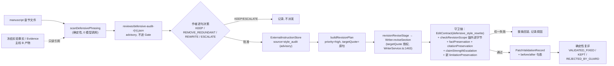

# M17.0 防御性学术写作 Skill 调研与集成方案裁决

> 性质：只读调研 + 架构方案。本轮**未**修改任何生产代码、Skill 目录、模型配置或冻结实验产物；未安装任何第三方 Skill；未调用真实模型。
> 日期：2026-11-04 · 基线：`main` @ `d205b34`（与 `origin/main` 一致，工作区干净）
> 范围：M17 主线 A（Anti-Defensive Academic Writing）。主线 B（实验数据导入/解析/冻结）不在本轮实施范围，但本方案的一切设计以“不破坏 B 的数据诚实性”为前提。

---

## 1. TL;DR 与单一优先推荐

**结论一句话**：不安装任何第三方 Skill 插件，也不新增 Agent / 硬门禁；借鉴 Kiterlin 与 OvOYu 的**判定规则**（Adkid 的叙事规则大部分弃用），在 PaperTeam 中复刻已被验证的 **M15.17 target_audit 模式**——“确定性候选扫描 → 只读 advisory 工件 → 作者逐句决策 → ExternalInstructionStore 机器转入 → 既有 `revision.revise` 的 targetQuote 定点修订 + EditContract + 守卫”——并为这一新来源补一个**确定性的限定语保全守卫**。

**单一优先推荐（主方案 = 方案 B 的“确定性检测 + 作者决策 + 既有定点修订”变体）**，修改位置：

| # | 位置 | 改动 |
|---|---|---|
| 1 | 新文件 `backend/src/review/defensivePhrasing.ts` | 中文防御性表达**候选**扫描（零模型调用），参照 `scanTemplatedPhrasing`（`backend/src/thesis/templatedPhrasing.ts:115`）与 `LIMITATION_PATTERNS`（`backend/src/review/crossSectionRedundancy.ts:105`）。只产出候选与先验类别，不判定科学真伪 |
| 2 | 新工件 `reviews/defensive-audit-r{n}.json` | 独立 advisory 工件，**不进入 `ReviewIssue` / Quality Gate**（规避 §4.3 所述 style 问题可能经 `blocking_issues_zero` 硬失败的路径） |
| 3 | `backend/src/review/externalInstructions.ts:30-58` | 新增来源 `style_audit`，并入 `isMachineAdvisorySource` |
| 4 | `backend/src/quality/editContract.ts:33-42, 96-108` | 新增 `source.kind = "defensive_style_rewrite"`：anchors 模式、`allowedOps ⊆ {replace_wording, delete_text}`、`hardNumericFreeze=true`、`allowNewValues=false`、`citationPolicy="preserve_existing_no_new"` |
| 5 | 新守卫（挂在 `revisionValidation.ts` 的 `evaluateRevisionValidation` 链上） | 限定语保全：锚外边界词/哨兵词多重集不变；锚内禁止新增强标记/因果/显著；否定与比较方向词永不减少；限定词仅在作者标记 `REMOVE_REDUNDANT` 的锚内允许减少 |
| 6 | 开关 `PAPERTEAM_DEFENSIVE_AUDIT`（默认 **off**） | 关闭即完全回滚，既有流程零变化 |

**为什么不直接装插件**：三个直接候选都是纯提示词、无任何独立实证；最热门的 Adkid（4981★）含“不说输”“打不过的维度不设为比赛”等会诱导选择性报告的条款；Kiterlin 的规则最好，但其仓库自带示例本身就在“去防御”时**补造数字**与**升级为“显著”**（§3.2）。PaperTeam 的价值在于可定位、可审计、可回放的受控修订——把一段提示词塞给模型再让它“自称没改事实”，恰恰是本仓库多轮里程碑反对的做法。

**最关键的源码事实**（决定了为什么不能走方案 C）：现有 `style_polish` 链路**在结构上禁止**删除“可能/不足/尚未/局限”——`SENTINEL_WORDS` 计数一变即阻断（`backend/src/review/styleInvariants.ts:53-79, 361-364`），`source_boundaries` 计数一变即阻断（`:366-372`），且 `academic-style-zh/SKILL.md:75-76` 第 9 条规定“反向弱化也不属于 style 修订”。这些守卫是正确的（防止风格润色偷改科学限定），不应为本功能放宽。

`M17_0_RESEARCH = COMPLETE`，`READY_FOR_M17_1 = YES（有条件）`——条件见 §9：作者需裁决 A/B 真实样本来源授权与人工评审人安排。

---

## 2. 仓库基线、Git 信息与调研范围

| 项 | 值 |
|---|---|
| 路径 | `D:\Projects\PaperTeam`（真实仓库） |
| 分支 | `main` |
| remote | `origin https://github.com/JiahongXu88/PaperTeam.git` |
| `git fetch origin` 后 HEAD | `d205b34086b8d3467de25d3e55150a1c259829dd` |
| `origin/main` | `d205b34086b8d3467de25d3e55150a1c259829dd`（同步） |
| 工作区 | 干净（`git status --short` 无输出） |
| 最近报告 | `docs/research/PUBLICATION_TARGET_REAL_MODEL_ACCEPTANCE.md`（ACCEPTED） |

调研方法：
- 五个 GitHub 候选仓库 `git clone` 到独立临时目录（`D:\tmp\m170_skills_20261104\`，PaperTeam 外），**只读查看源码，未执行任何安装脚本**（Kiterlin 的 `curl … | sh` / `Invoke-RestMethod` 安装方式仅审阅，未运行）。
- PaperTeam 源码审计覆盖 Skill Loader、Writer、Reviewer、Revision、EditContract、守卫、Quality Gate、发表目标策略；关键结论由第二遍人工抽查复核（`styleInvariants.ts`、`revisionPlan.ts:360-366`、`ReviewAggregator.ts:165-182`、`editContract.ts`、`WriterService.ts:156-160, 1463, 1629`、`routing.ts:63-68`、`stylePolicy.ts:44-52`、`claimStrength.ts:184-200`、`externalInstructions.ts:30-58`、`academic-style-zh/SKILL.md:30-42, 72-77`）。
- 未追加额外 GitHub 候选：五个指定候选已覆盖“反防御规则 / 论断核验 / 科学严谨性”三类需求，再加只会重复同一套规则（筛选标准：须有 SKILL 文件、明确许可、与已有候选非重复的独特机制；本轮未发现值得占用名额者）。

---

## 3. GitHub 核查表

Star/Fork 查询日期 2026-11-04（GitHub API）。**Star 不等于质量**。

### 3.1 总表

| 候选 | Pinned SHA | 许可 | Star/Fork | 维护 | 形态 | 实证 | 复用决定 |
|---|---|---|---|---|---|---|---|
| [Adkid-Zephyr/anti-defensive-writing-Skill](https://github.com/Adkid-Zephyr/anti-defensive-writing-Skill/tree/82d31402caa0db1790026824399044538483171b) | `82d31402caa0db1790026824399044538483171b`（2026-10-07） | MIT © Adkid-Zephyr | 4981 / 114 | 8 commits，单作者 | 纯提示词（中/英 SKILL.md 5.6/6.5 KB + 精简 prompt + Codex 插件打包脚本） | 无；README“效果对比”为演示 | **REJECT（叙事/语言/默认决策规则）+ REFERENCE_ONLY（实验职责四分类、摘要前五句自查）** |
| [Kiterlin/anti-defensive-writing](https://github.com/Kiterlin/anti-defensive-writing/tree/f516147d017a3fe43ae99192cb89d8261b0c8679) | `f516147d017a3fe43ae99192cb89d8261b0c8679`（2026-10-17） | MIT © Kiterlin | 1671 / 54 | 54 commits，有外部贡献者，CI | 纯提示词（单 SKILL.md 23 KB，中英双语）+ 安装脚本及其测试 + 3 个英文示例 | 无；CI 只测安装器与文件镜像，**不测写作效果** | **ADAPT（判定规则）；REJECT（示例作为测试数据、README 演示）** |
| [OvOYu/anti-defensive-writing](https://github.com/OvOYu/anti-defensive-writing/tree/bdab0d2aeb082798ad71cac3ab24a616d2d82894) | `bdab0d2aeb082798ad71cac3ab24a616d2d82894`（2026-09-08） | MIT © Kiterlin + © Adkid-Zephyr（保留双上游版权） | 6 / 0 | **1 commit**，此后未更新 | 纯提示词（SKILL.md 7 KB + 4 个 references + agents/openai.yaml） | 无；`references/examples.md` 明示为构造材料 | **ADAPT（句子作用→处理表、优先级、audit 模式、事实保持检查单、构造对抗例）；不作依赖** |
| [ShaishavMaisuria/research-paper-lifecycle-skills](https://github.com/ShaishavMaisuria/research-paper-lifecycle-skills/tree/cf30d6452cc6fd0570dd760eb65696f4a3485398) | `cf30d6452cc6fd0570dd760eb65696f4a3485398`（2026-10-24） | Apache-2.0 + NOTICE（再分发须保留） | 59 / 22 | 活跃 | 提示词 + stdlib Python linter（`claim_audit.py`、`prose_lint.py`） | 无效果实证 | **ADAPT（back/scope/cut 三选一、“强度变化句逐条签字”before/after 表）；REJECT（linter：仅英文正则）；REFERENCE_ONLY（其余）** |
| [K-Dense-AI/scientific-agent-skills](https://github.com/K-Dense-AI/scientific-agent-skills/tree/a25cf9ec00e2745d03f8704acf6f6919694ccd9a) | `a25cf9ec00e2745d03f8704acf6f6919694ccd9a`（2026-11-02） | MIT © K-Dense Inc. | 56022 / 4925 | 非常活跃 | 大型 Skill 库，含脚本与测试（测的是脚本，不是写作效果） | 无写作效果实证 | **REFERENCE_ONLY**——已是 PaperTeam `academic-writing-zh` / `academic-review` 的上游（`0b2afe68…`），无反防御专门内容 |

### 3.2 逐个候选的实质审查（区分四层：README 宣称 / Skill 文本 / 仓库示例 / 独立实证）

**A. Adkid-Zephyr（“学术发布会原则”）**
- *Skill 文本实际表达*（`skills/anti-defensive-writing/SKILL.md`）：“只围绕优势组织论文……没有形成优势的内容，不进入主线”；“打不过的维度，不设为比赛项目……重新选择……评价维度、应用场景、约束条件或比较口径”；“**不说输**。面对不占优的结果，不使用‘本文弱于’‘性能下降’‘未能超过’”；“默认决策规则”第 1 条“删除与核心主张无关的内容”、第 7 条（最后）才是“只有在无法回避且确实影响核心结论时，才进行必要说明”；实验“无法强化主线……删除、弱化、移动或重新设计”。（MIT，短引用。）
- *风险*：全文**没有**任何“不得隐瞒不利结果 / 不得事后换口径”的保护句（英文版同样只在 #5 写了“只提出证据能牢固支撑的主张”）。“打不过就换评价维度”与事后挑选指标（HARKing / outcome switching）在操作上不可区分；“不说输”直接禁止了“性能下降”这一可能是**必要事实**的表达；默认决策序把披露放在最后。
- *值得保留的部分*：实验四类论证职责（有效性 / 机制 / 场景价值 / 排除替代解释）；“摘要前五句里问题和贡献出来了吗”“结论里有没有突然的自我否定”两条自查。
- *README 宣称*：“效果对比”表为演示，无实验。
- *外部命令*：`scripts/build_plugin.py` 只打 zip，无网络/危险操作。

**B. Kiterlin**
- *Skill 文本*：核心价值在于（1）“必要限定”的五条判据（影响论断成立 / 证据解读 / 适用范围 / 研究设计 / 读者正确使用）；（2）防御句六分类（不必要免责 / 必要范围条件 / 真实方法局限 / 有用概念对比 / 证据型限定 / 冗余澄清）；（3）“负向限定→正向范围”；（4）“确有不确定性时说明来源”；（5）中文谦辞清单（“仅仅做了初步尝试”“只能提供有限参考”“仍有很大提升空间”）及“‘初步’‘可能’‘提示’符合研究情况时应当保留，不要为了显得有力加上‘显著’‘全面领先’”；（6）不利结果处理五步与“会影响核心结论的不利结果必须保留”；（7）“Examples illustrate phrasing; they do not supply facts”。
- *仓库示例与 README 和 Skill 文本自相矛盾*（重要）：
  - `examples/methods-and-contributions.md` 的 “After” 段新增了 “2.4× throughput”“42% reduction in peak VRAM”“perplexity (<0.08)”“4k to 64k tokens”，这些数字在 “Before” 中**完全不存在**——这是“去防御”时补造事实的反面示范。
  - `README.zh-CN.md:85` 把“在某种程度上或许可能潜在提示 X 对 Y 具有一定影响”改为“实验证据表明……X 对 Y 产生**显著**影响”——正是其 SKILL 所禁止的升级。
  - SKILL 自带示例“虽然样本有限……仍能提供一些有用的启示”→“该样本涵盖了与本研究理论问题最相关的差异”，把“样本有限”改为了一个更强的、需要证据的代表性论断（OvOYu 也专门点名了这一模式）。
  - 结论：**只能借鉴规则文本，不能把其示例当测试金标准**。
- *外部命令*：README 推荐 `curl … | sh` 与 PowerShell `Invoke-RestMethod` 远程执行安装。本轮未执行；即便采用规则也不应采用此安装方式。
- *维护*：活跃；但 2026-09-30 之后 SKILL 从 185 行扩展到约 580 行（`git diff 0087464..f516147 -- SKILL.md` 395 行新增），规则漂移快，**不宜作为运行时依赖**。

**C. OvOYu（整合版）**
- *独立增量（确认非简单拼接）*：明确优先级“事实与必要披露 → 主张和证据一致 → 论证结构 → 表达力度”；`audit/polish/restructure/draft` 四模式且 `audit` 明确“不修改源文件”；“按句子作用判断，**不使用词语黑名单**”的五行处理表；“‘仅需少量标注’可以表达优势；‘准确率下降’可以是必要事实。把‘样本有限’改成‘样本具有代表性’……会增加证据责任，不能作为语言润色”；“区分‘与主张无关’与‘结果不利’”；“事后发现的有利子集或指标不能伪装成预先确定、广泛成立的优势”；`references/provenance.md` 明确记录“将不利结果一律回避、按输赢选择评价维度及示例中补造结果的倾向”**替换**掉。
- *局限*：1 commit / 6★ / 无测试；整合的 Kiterlin 版本是旧的 `0087464`（185 行，早于 Kiterlin 中文与论文规则扩充），因此**与 Kiterlin 新版并非独立来源**——两者的中文规则高度趋同，不能当两份独立验证。
- *外部命令*：无脚本。

**D. ShaishavMaisuria（辅助）**
- `verify-claims/SKILL.md`：“the skill cannot decide whether a claim is true”；back / scope / cut 三种诚实处理，“never the fourth move: inventing evidence”；“Do not use the model's self-assessment as the verification signal”。与 PaperTeam M15 的确定性守卫理念一致。
- `polish-prose/SKILL.md`：编辑前冻结“no-touch inventory”（数字、引用键），编辑后 diff；“Every sentence whose claim strength changes goes into the before/after table … for explicit user sign-off”。
- `prose_lint.py` 的 `DOUBLE_HEDGES` / `HEDGE_WORDS` 均为英文正则，**中文零覆盖**；PaperTeam 已有更强的中文 `factPreservation` / `citationPreservation`，不需引入。

**E. K-Dense（辅助）**
- `scientific-writing/SKILL.md` “Scientific fidelity” 段：保留不确定性、报告负/零/失败结果、“Do not convert association into causation or non-significance into equivalence”。这些已经以 `academic-writing-zh`（同上游，`0b2afe68…`）的形式进入 PaperTeam。无任何“去防御”内容，引入只会重复。

---

## 4. 与 PaperTeam 现有能力的逐项重叠分析（源码证据）

标注：【代码】存在 /【测试】有测试 /【产品】真实流程已调用。

### 4.1 Skill Loader 与三个学术 Skill
- 种子目录 `backend/skills/seed/<id>/`，`skill.json` + `SKILL.md` + `UPSTREAM_SKILL.md`（哈希固定）+ `LICENSE` + `PROVENANCE.md`；`validateSeed` 要求 40 位 SHA、LICENSE、PROVENANCE（`backend/src/skills/SkillRegistry.ts` ~`:500-546`）。【代码】【测试 `backend/test/skills/academicSkills.test.ts`、`skillRegistry.test.ts`】【产品】
- 路由 `DEFAULT_SKILL_ROUTES`（`backend/src/skills/routing.ts:36-129`）：`review/style → academic-style-zh`（`:63-68`）；`review/academic*`、`review/section`、`review/fullpaper → academic-review`；Writer 各 scope → `academic-writing-zh`；`writing/style-polish → academic-writing-zh + academic-style-zh`（`:117-122`）。
- **注入方式是渐进披露**：`PiRuntimeAdapter.createPiSession`（`backend/src/runtime/PiRuntimeAdapter.ts:2596-2702`）只把 `<available_skills>` 名称/描述/位置放进系统提示，SKILL.md 正文**仅当模型主动 `read` 时**才消耗 token；业务提示中没有“必须读取 SKILL.md”的指令。→ **推论**：把新规则只写进 SKILL.md（方案 C），模型是否真正读到不受控；需要强约束的规则必须进入业务提示或确定性代码。
- `academic-style-zh/SKILL.md:30-42` 的模式表**没有“过度限定/谦辞”行**；`PROVENANCE.md:36` 声称保留了“过度限定”，上游 `UPSTREAM_SKILL.md:382-390`（Humanizer-zh #23）有此条，但未移植。这是**文档与实现不一致**的小缺口，也是最自然的词汇挂点。
- 谦辞 / 自谦 / 道歉 / “水平有限”/“敬请批评指正”/“SOTA”：全仓 `src/` 与种子 Skill 中**均未找到**。

### 4.2 Writer：既有规则倾向“多加限定”，而非“去防御”
- `MANUSCRIPT_CONTENT_LINES`（`backend/src/writer/WriterService.ts:156-160`）已有“相关结论处保留必要限定，**不在引言、方法、讨论机械重复免责**”——这是现存唯一的反重复免责规则（与 `academic-writing-zh` M13.7.2 段一致）。
- 同时多处要求加限定：`buildSectionPrompt` 规则 3“证据不足时显式弱化表述或标注”（`:2136`）；综述规则 5 推测语气（`:2223`）；学位论文 `limitationMode`（`backend/src/thesis/thesisWritingContext.ts:151-155`）；发表目标基线维度 `honest_uncertainty`“证据不足时标注待核验，不下确定结论”（`backend/src/review/publicationPolicy.ts:260`）。
- 观察：PaperTeam **自身生成的稿件**里一部分“防御性”句子是这些提示诱导的，且其中大量（如综述“仅基于摘要”“不作横向排序”）是**真实的证据范围事实**，必须保留。因此方案 A 不能简单地“让 Writer 少限定”。
- 修订提示已有 targetQuote 授权：“唯一允许修改的原文……此引文之外的目标节文本必须逐字保留”（`:1463`）；规则 7b 禁止“新增与未弱化旧论断并存的对冲表述”（`:1629`）。【代码】【产品】

### 4.3 Reviewer、Finding schema 与 Gate
- `ReviewIssue`（`backend/src/agents/ReviewerService.ts:103-170`）；`IssueCategory` 含 `"style"`（`:92`）；severity `critical|major|minor`。
- 摘要（digest）路径的 style lens 读 `academic-style-zh`，输出 `riskScore`（`ReviewerService.ts:1239-1256`）；**长文档 unit 路径** `contextScope: "review/academic/unit"`（`:520`）**不路由 `academic-style-zh`**，style 结果 `issues: []`、只有加权 riskScore（`definitions.ts:1404-1455`）。真实论文多数走 unit 路径 → 现有 style lens 对真实长稿的句级覆盖基本为零。
- Gate：`style_risk_threshold`（`backend/src/quality/gates.ts:956-962`）在生产被 `applyQualityPolicy` 降为 ADVISORY；但 `ReviewAggregator.ts:165-182` 对**所有类别**统计 critical/major/blocking，`blocking_issues_zero`（`gates.ts:890`）与 `open_critical_major_zero`（`:915`）不排除 `style`。→ **若把防御性问题作为 `ReviewIssue` 塞进 review，模型一旦给出 `major` 就会造成科学 Gate 硬失败**。这是选择“独立 advisory 工件”而非扩展 `ReviewIssue` 的决定性理由。（这一通用缺口本身值得单独修，但不在 M17 主线内，见 §9。）

### 4.4 Revision、EditContract 与 Style Revision Loop
- `buildRevisionPlan`：minor → `skipped`“minor：已记录，不进入自动修订”（`backend/src/review/revisionPlan.ts:360-366`，D-0026）。→ 防御性风格问题若以 minor ReviewIssue 存在，**质量回路永远不会派发**。
- Style 回路（D-0031）：`isPolishableStyleIssue` 只收 minor、非 blocking 的 style 问题（`backend/src/review/stylePolicy.ts:44-52`）；`polishSectionStyle` 让 Writer **整节输出**（`WriterService.ts:727, 1358-1373`），随后 `checkStyleInvariants` 全有或全无地校验——`SENTINEL_WORDS`（`styleInvariants.ts:53-79`，含“可能/不足/不能/无法/证明/表明/显著”）计数变化即阻断（`:361-364`），边界词（仅/部分/尚缺/尚未/局限/负结果/未经验证/不支持/未覆盖）计数变化即阻断（`:366-372`）。→ **现有 style 回路在结构上无法完成去防御**，且不是 quote 级补丁。
- 质量回路的定点补丁机制可复用：`projectFindingTarget`（`findingProjection.ts:68`）→ `revisionReviseStage`（`definitions.ts:3319`）→ `applyRevisionSpan`（`revisionScope.ts:188`）→ `checkRevisionScope` 锚外逐字节一致（`:321-338`）→ `PatchValidationRecord`（`patchValidation.ts:27-66`，before/after 哈希 + scope/fact/citation/evidence/editContract 判定，落盘 `reviews/patch-validation-rev-N.json`）。【代码】【测试】【产品】
- `EditContract`（`backend/src/quality/editContract.ts`）：`source.kind`（`:33-42`）、`EditOperation`（`:65`）、`EditContractConstraints`（`:96-108`，含 `hardNumericFreeze`、`citationPolicy`、`unenforceable` fail-closed）。【代码】【测试 `editContract*.test.ts`】【产品】
- **target_audit 通道（M15.17）是最贴合的模板**：`TargetAuditRevisionService.ts:1-31` 头注释描述的正是“advisory 工件 → 确定性分类 → 锚投影（quote 回放核验）→ 作者逐项决策 → `ExternalInstructionStore(source="target_audit")` → 既有 revision 工作流派发 Writer，全套 Patch/Fact/Citation/Scope 守卫原样生效 → 确定性复评”，且“本服务不执行任何模型调用”。机器来源在计划中 priority=high 而非 mandatory（`revisionPlan.ts:283-292`；`externalInstructions.ts:56-58`）。

### 4.5 守卫
- 事实保持 `evaluateFactPreservation`（`backend/src/quality/factPreservation.ts:1602`）、结论翻转 `detectClauseConclusionFlips`（`:1453`）、新增“显著”断言计数（`:1507-1518`）。【代码】【测试】【产品】
- 引用保持 `citationPreservation.ts:161, 315`；命名引用 `namedReferenceGuard.ts:193`。
- 论断强度 `checkClaimStrengthEscalation`（`backend/src/quality/claimStrength.ts:184-243`）：**只拦截升级到 strong**（`STRONG_MARKERS :50-75`，含 显著提升/全面超越/彻底解决/证明 等）；**弱→中（删一个“可能”）不被拦截**——对去防御正好合适；但它**也不会拦截删除“尚未在外部数据集验证”**这类必要限定 → 需要新守卫（§6.4）。
- `scanStyleSignals` 的 overclaim 正则（`styleSignals.ts:60-64`）**只在测试与 `scripts/m5-acceptance.mjs` 中被调用**，不在产品流程。
- M15.1 claim ledger（`claimAudit.ts`）为 shadow；M15.3.1 `stripComparatorPhrases` 是数值绑定逻辑，与过度声明检测无关。

### 4.6 是否已有“句级定位 + 证据适配改写 + 数值/引用保持 + before-after 审计”
**部分已有**：句级定位（quote 投影）、锚外逐字节保护、数值/引用守卫、before/after 哈希记录——全部来自质量回路与 target_audit 通道。**缺的只有三块**：中文防御性候选检测、作者逐句裁决入口、对“必要限定被删除”的确定性守卫。

### 4.7 净增益评估
- 现有能力已覆盖：过度声明（显著/首次/彻底）的写作约束与升级拦截；跨章节重复免责的检测（`crossSectionRedundancy` 类 L，仅进 digest 提示）。
- 净增益：①对**单句内**的 hedge 堆叠、谦辞、预先道歉、贡献自贬的可定位检测（目前为零，长文档路径尤甚）；②一条能**合法地**删除冗余限定词、又不放宽 style 守卫的修订通道；③对“删掉必要限定”的确定性兜底（目前只有 style 回路有，质量回路没有）。
- 成本：检测零模型调用；修订仅对作者批准的句子按节批量派发 Writer（每个涉及章节 1 次 revise 调用，与既有 target_audit 派发同量级）；无新增 Reviewer 调用。值得做，但必须先过 §8 的 A/B。

---

## 5. 防御性写作 taxonomy 与科研边界

### 5.1 判定动作
- **DETECT**：扫描器命中候选（仅表示“值得看一眼”，不代表应改）。
- **KEEP**：保留原句（必要限定、负结果、真实不确定性、已准确清晰）。
- **REWRITE**：在锚内改写，不增删事实、不升级强度。
- **ESCALATE_TO_AUTHOR**：涉及科学判断（是否必要、是否影响结论、证据是否足以去掉限定），系统不自行决定。

### 5.2 Taxonomy

| 类 | 典型信号 | 默认动作 | 何时 KEEP | 何时 ESCALATE |
|---|---|---|---|---|
| D1 hedge 堆叠 | 同一小句 ≥2 个弱化词（可能/或许/在一定程度上/潜在/似乎/有望） | REWRITE：保留**一个**与证据对应的限定 | 多个限定各自承载不同信息（如“在小样本上……可能”） | 无法判断原证据强度时 |
| D2 无信息谦辞/道歉 | 粗浅尝试、抛砖引玉、水平有限、不足之处在所难免、敬请批评指正、仅仅做了初步 | REWRITE（删除或改为具体范围陈述） | 学位论文致谢/后记的礼节性用语（不在正文论证中） | — |
| D3 预先免责/想象中的审稿人 | 本文并不声称……/这并不意味着……/需要澄清的是……（无证据作用） | REWRITE：负向→正向范围 | 该否定承载真实的范围事实且无法正向表达而不失信息 | 删除后可能使读者误解结论范围 |
| D4 贡献/结果被埋没 | “在一定程度上改善了”而证据是同协议、多次运行、有方差的明确提升 | ESCALATE（需证据核对后才能改强） | 证据确实只是部分支持 | 默认 ESCALATE；系统不得自行强化 |
| D5 重复局限声明 | 同一局限在摘要/引言/各章结论反复出现 | REWRITE：保留局限章节及其结论必需处一处 | 摘要中省略会误导的限定 | 判断“是否必需”有分歧时 |
| K1 必要条件性语言 | 探索性分析、小样本、未外部验证、观察性相关、统计不确定性、限定场景 | **KEEP**（可改为更精确的表述，不可删除） | 恒保留 | 作者主张“已有证据可去掉”时，须给出证据引用 |
| K2 必须披露的负结果/不可比/代价/失败 | 低于基线、协议不同、额外资源、失败模式、与主表冲突 | **KEEP**（可去情绪化：“遗憾的是”→客观陈述） | 恒保留 | 作者想移出正文时（只能移位，不能删除；且摘要不得因此误导） |
| O1 无证据强断言（防过度声明，**非风格弱化**） | 显著（无检验）、首次、普遍适用、全面优于、SOTA | **不属于本功能的改写方向**；交既有 claimStrength / Reviewer 处理；本功能的守卫保证**不新增**此类词 | — | 由现有 academic lens 报告 |

### 5.3 中文句子级样例（全部**人工构造**，数字仅为说明用途，**不是任何真实实验结果**）

| # | 原句（人工构造） | 已知材料（人工构造） | 判定 | 处理后 |
|---|---|---|---|---|
| 1 | 本文仅是一次粗浅的尝试，难免存在诸多不足，敬请批评指正。 | 无 | D2 → REWRITE | 删除；如需要，改为“本文在 A、B 两个数据集上评估所提方法。” |
| 2 | 实验结果或许在一定程度上可能表明，引入时序模块有助于降低 ID 切换。 | 同协议、3 次运行，IDSW 均低于消融版本，无显著性检验 | D1 → REWRITE | “实验结果表明，引入时序模块后 IDSW 降低（3 次运行均一致，未做显著性检验）。” |
| 3 | 本文方法的 HOTA 提升了 1.2，具有显著优势。 | 单次运行，无检验 | O1（非本功能改写方向） | 本功能 KEEP 原样并**报告给既有 academic lens**；若进入修订，守卫禁止新增“显著”，建议由作者改为“HOTA 提升 1.2（单次运行）”——这是**弱化**，需作者授权（既有 `weakeningAuthorization`） |
| 4 | 由于未在夜间场景数据上验证，结论能否推广到低照度条件尚不确定。 | 确实未验证 | K1 → **KEEP** | 原样保留（可选：移到局限性节，但相关结论处仍保留一处） |
| 5 | 在 C 数据集上，本文方法的 MOTA 低于基线 0.8。 | 真实结果 | K2 → **KEEP** | 原样保留；**禁止**改写为“在 C 数据集上取得了具有竞争力的结果”（这正是 Adkid“不说输”会诱导的改写） |
| 6 | 遗憾的是，本文方法在 C 数据集上仍明显落后，效果有限。 | 同 #5（低 0.8） | D2 情绪化 + K2 事实 → REWRITE（只去情绪，保事实） | “在 C 数据集上，本文方法的 MOTA 比基线低 0.8。” |
| 7 | 我们并不声称该方法适用于所有交通场景。 | 实验仅覆盖城市道路白天场景 | D3 → REWRITE（负向→正向，信息不丢） | “实验覆盖城市道路白天场景。” |
| 8 | 观察到车流密度与跟踪误差呈正相关，这或许说明密度可能导致误差上升。 | 观察性相关 | D1 + 因果风险 → REWRITE | “车流密度与跟踪误差呈正相关；本实验设计不能区分因果方向。”——**禁止**改为“密度导致误差上升” |
| 9 | 由于两种方法的训练数据不同，表 3 中的比较不能视为同条件对比。 | 确实不同 | K2 不可比 → **KEEP** | 原样保留 |
| 10 | 本文首次将遮挡推理引入车辆跟踪。 | 文献调研发现已有先例 | O1 → ESCALATE（交既有 academic/citation 审查） | 本功能不改；如作者授权修订，只能缩窄（“在 X 设定下……”）或删除 |
| 11 | 本文在 A、B 两个公开数据集上评估所提方法，并在局限性一节讨论跨域泛化。 | — | 已准确清晰 → **KEEP**（负例/假阳性控制） | 不改；若扫描器命中“局限”字样，判定应为 KEEP，计入误报率 |
| 12 | 需要指出的是，本文的方法也存在一定的局限性，当然这并不影响其整体有效性。 | 无具体局限内容 | D3（空洞免责 + 自我辩护）→ REWRITE | 删除；若存在真实局限，改为具体陈述并放局限性节——**系统不得自造局限内容**，缺失时 ESCALATE |
| 13 | 该方法在一定程度上可以缓解遮挡问题。 | 遮挡子集上 IDF1 提升，但仅 1 个数据集、单次运行 | D4 候选 → **ESCALATE** | 系统不自行改强；作者可选：“在 D 数据集的遮挡子集上，IDF1 由 x 提升至 y（单次运行）”（数字须来自冻结实验事实） |

### 5.4 Adkid 条款审查：合法聚焦 vs. 隐瞒不利证据

**明确界限**：
- **合法**：在**预先确定**的研究问题与评价协议下，选择主叙事、压缩与主张无关的探索过程、把冗余实验移到附录、把一个弱指标准确写成“权衡”（同时给出收益与代价）。
- **越界**：结果出来后才更换评价维度/数据集/口径以取得优势而不披露；删除或不报告**与核心主张相关**的不利结果；把“性能下降”改成“具有竞争力”；把未解释的劣势“解释为目标差异/合理权衡”而无依据；移入附录导致摘要或结论产生误导。

| Adkid 条款 | 决定 | 理由 / 改写 |
|---|---|---|
| 只围绕优势组织论文，没有形成优势的内容不进入主线 | 改写后参考 | → “围绕证据支持的主要贡献组织；与主张相关的不利结果须保留”（Kiterlin/OvOYu 已如此改写） |
| 打不过的维度，不设为比赛项目；重新选择评价维度或比较口径 | **REJECT** | 与事后换口径不可区分；改为 OvOYu 版“按研究问题选择评价维度并说明理由，不因结果不利更换标准” |
| 不说输；不使用“本文弱于”“性能下降”“未能超过” | **REJECT** | “性能下降”可能是必要事实；只允许去除情绪化修饰（“遗憾的是”“仍明显落后”） |
| 不占优结果按 ①是否必须讨论 ②换角度解释 ③权衡 ④收缩主张 ⑤调整主线 处理 | 改写后参考 | 保留 ④（收缩主张）；②③ 仅在有依据时；①的判定交作者（ESCALATE），且“影响结论即必须讨论” |
| 实验无法强化主线则删除、弱化、移动或重新设计 | **REJECT“删除/弱化”**，参考“移动” | 实验存废是科研决定，不是写作风格；PaperTeam 不得在写作环节删除实验结果（主线 B 的冻结实验事实优先） |
| 默认决策规则（删除→……→最后才必要说明） | **REJECT** | 优先级应倒置：事实与必要披露第一 |
| 实验四类论证职责；摘要前五句自查；结论不突然自我否定 | REFERENCE_ONLY | 可作为 Reviewer 建议文案来源，非强制 |

**原则：实验数据与论文事实永远优先于任何 Skill 风格原则。**

---

## 6. 方案比较、推荐工作流与修改点

### 6.1 三方案比较

| 维度 | A：Writer 初稿轻量指导 | B：只读句级 audit + 既有定点修订 | C：仅增强 academic-style-zh / style loop |
|---|---|---|---|
| 覆盖 | 新写作（综述/研究论文/学位论文）；**不覆盖 Existing Paper** | 所有已有稿件（含导入的 Existing Paper、学位论文章节） | 只覆盖 digest 路径的 style lens；**长文档 unit 路径不路由此 Skill** |
| 可定位性 | 无（只影响生成分布） | 句级 quote 锚，可回放 | 无句级锚（style polish 是整节输出） |
| 能否合法删除冗余限定 | 不涉及 | 能（新 EditContract kind + 新守卫） | **不能**：`SENTINEL_WORDS` / `source_boundaries` 计数变化即阻断；SKILL 第 9 条禁止 |
| 科学风险 | 中：全局提示变化可能同时减少**必要**限定（现有提示大量要求限定），影响主线 B 的事实表述 | 低：作者逐句批准 + 确定性守卫 + 锚外逐字节保护 | 若为此放宽守卫则高；不放宽则做不成 |
| Token / 延迟 | 每次写作多 1–2 行提示，可忽略 | 检测 0；修订每涉及章节 1 次 Writer 调用（仅作者批准后） | 0–少量 |
| 评估性 | 难以归因 | 每句 before/after 可人工评 | 难 |
| 维护 | 低 | 中（新增 1 扫描模块、1 守卫、1 kind、1 来源） | 低 |

### 6.2 裁决
- **主方案：B**（“确定性检测 + 作者决策 + 既有定点修订”变体）。不新增 Reviewer 模型调用：检测由确定性扫描器完成，“必要性判断”由扫描先验 + **作者**决定，系统只在作者批准的锚内调用既有 Writer 修订。
- **组合：A 作为 A/B 中的可选独立实验臂**，默认关闭（`PAPERTEAM_ANTI_DEFENSIVE_WRITER_HINT`），只在 `MANUSCRIPT_CONTENT_LINES`（`WriterService.ts:156-160`）追加一行：“不写不含信息的谦辞、道歉与预先免责；同一结论只保留一个与证据来源对应的限定，并说明不确定性的来源。”是否默认开启取决于 §8 结果。**不做两遍模型审核**：A 不引入审核，B 不引入新的 Reviewer 调用。
- **C 只做最小词汇补丁（可选，REFERENCE）**：在 `academic-style-zh/SKILL.md` 模式表补上“过度限定/谦辞”一行（兑现 `PROVENANCE.md:36` 的声明），修订方向写明“**仅报告**；不在 style 润色中改动限定强度（第 9 条），改动经 style_audit 通道由作者决定”。**不放宽 `styleInvariants.ts` 任何规则。**
- **备选方案（若 §8 显示扫描器召回过低）**：在候选之上增加**一次**按节批量的 LLM 判定调用（只对候选句输出 KEEP/REWRITE/ESCALATE + 理由，不产出改写），作为作者决策的辅助信息；仍不进入 Gate，仍需作者批准。

### 6.3 工作流



### 6.4 最小数据契约（对照真实 schema 的最小改动）

不修改 `ReviewIssue`。新工件条目（新类型 `DefensiveAuditItem`，`defensive-audit/v1`）：

```ts
interface DefensiveAuditItem {
  id: string;                      // 内容哈希（含 file + 原句 + manuscript 指纹），防陈旧
  file: string;                    // manuscript 章节文件
  logicalSection?: string;         // 复用 logicalSpan 的 span id
  originalText: string;            // 逐字原句（即后续 targetQuote；必须可唯一回放）
  issueKind: "hedge_stacking" | "apology_modesty" | "preemptive_disclaimer"
           | "buried_contribution" | "repeated_limitation";
  matchedMarkers: string[];        // 命中的确定性信号（可审计）
  necessityPrior: "likely_redundant" | "needs_judgment" | "likely_necessary";
                                   // 扫描器先验；含 K1/K2 信号（未验证/不可比/低于/负结果…）一律 likely_necessary
  evidenceRefs: string[];          // 同句涉及的数字/引用键/实验事实 id（只读，用于保护）
  preservationConstraints: {       // 由确定性抽取生成，供守卫使用
    numbers: string[]; citationKeys: string[];
    negationAndDirection: string[];   // 未/不/低于/高于/不显著…：永不减少
    limitationTerms: string[];        // 仅/尚未/未经验证/局限…：仅 REMOVE_REDUNDANT 时允许减少
  };
  proposedAction: "rewrite_in_place" | "delete_sentence" | "move_to_limitations" | "none";
  authorDecision?: { decision: "KEEP" | "REMOVE_REDUNDANT" | "REWRITE" | "ESCALATE"; at: string; note?: string };
  outcome?: "VALIDATED_FIXED" | "KEPT" | "REJECTED_BY_GUARD" | "NOT_DISPATCHED";
}
```

- 无 `confidence` 数值字段：扫描器不输出伪概率，只输出命中信号与三档先验（与 `FORBIDDEN_DETECTOR_FIELDS`，`ReviewerService.ts:176` 的立场一致）。
- `move_to_limitations` 在 M17.1 **不实现**（跨节移动超出单锚补丁能力），只作 ESCALATE 提示。

### 6.5 新守卫 `limitationPreservation`（仅对 `defensive_style_rewrite`）
确定性、fail-closed，复用 `styleInvariants.ts` 的抽取函数（不改其行为）：
1. 锚外：`SENTINEL_WORDS` 与边界词多重集**完全不变**（已由 `checkRevisionScope` 的逐字节检查覆盖，此处做二次断言）。
2. 锚内：`STRONG_MARKERS`（`claimStrength.ts:50-75`）、“显著/首次/证明/导致/优于/全面/SOTA”计数**不得增加**。
3. 锚内：否定与比较方向词（未/不/无法/不显著/低于/高于/降低/增加…）**不得减少**。
4. 锚内：弱化/边界词（可能/或许/仅/尚未/未经验证/局限…）减少**仅当** `authorDecision = REMOVE_REDUNDANT`；`necessityPrior = likely_necessary` 的条目即便作者批准也须二次确认（UI 显式警示）。
5. 数字与引用键：`hardNumericFreeze` + `preserve_existing_no_new`（由 EditContract 执行）。
6. 守卫的通过**不等于**语义正确的证明（与 `styleInvariants.ts:361, 366-367` 注释同一立场）；它只是阻断最常见的越权模式，人工 before/after 仍是最终裁决。

### 6.6 预期改动文件（M17.1）

| 文件 | 改动 | 预估规模 |
|---|---|---|
| `backend/src/review/defensivePhrasing.ts`（新） | 扫描器 + 类型 | ~250 行 |
| `backend/src/review/defensiveAudit.ts`（新，或并入上文件） | 工件读写、指纹、作者决策、复评；参照 `TargetAuditRevisionService` | ~300 行 |
| `backend/src/review/externalInstructions.ts:30-58` | 新来源 `style_audit` + label + advisory | ~5 行 |
| `backend/src/quality/editContract.ts:33-42` | 新 kind `defensive_style_rewrite` 及构造函数 | ~40 行 |
| `backend/src/review/revisionValidation.ts`（`evaluateRevisionValidation`） | 挂接 `limitationPreservation` | ~120 行（守卫本体可放新文件） |
| `backend/src/writer/WriterService.ts:1463` 附近 | source=style_audit 时追加 3 行修订纪律（只改锚内；不增事实；不加强） | ~10 行 |
| `backend/src/httpServer.ts` | `POST /projects/:id/defensive-audit`（生成）与 `…/decide`（决策），复用 target audit 的 409 防陈旧口径 | ~120 行 |
| 测试 `backend/test/review/defensivePhrasing.test.ts`、`defensiveAuditRevision.test.ts`、`limitationPreservation.test.ts`（新） | 含 §5.3 全部样例作为固定用例 | — |
| 可选：`WriterService.ts:156-160`（A 臂，flag 默认 off）；`academic-style-zh/SKILL.md` 模式表一行 | — | 各 1–3 行 |

M17.1 **不做 UI**（A/B 用脚本驱动 API 即可）；UI（作者逐句决策面板）放 M17.2，前提是 A/B 通过。

---

## 7. 明确不实施的功能与理由

1. **不安装 / 不入库任何第三方 Skill**（包括放进 `backend/skills/seed/`）：纯提示词、无实证；Adkid 有偏差条款；Kiterlin 示例自相矛盾且规则快速漂移；OvOYu 无维护。借鉴的规则由 PaperTeam 以中文自写，`PROVENANCE` 式注明灵感来源与固定 SHA；如未来逐字引入大段文本，须随附 MIT 版权声明（OvOYu 需同时保留 Kiterlin 与 Adkid 两份）。
2. **不新增 Agent、不新增 Reviewer 模型调用**：检测确定性即可达成候选生成；必要性判断属于作者。
3. **不新增 Quality Gate 规则、不把防御性问题放进 `ReviewIssue`**：风格建议 ≠ 科学错误；避免 §4.3 的 style→major→硬失败路径。
4. **不放宽 `styleInvariants.ts`**，不改 `academic-style-zh` 第 9 条：style 润色仍不得改动结论强度。
5. **不实现 Adkid / OvOYu 的 `restructure` 模式**（重定位贡献、重选主结果）：属于科研叙事决定，越过“最小补丁”边界。
6. **不自动应用**：无作者批准不派发 Writer。
7. **不修改 `honest_uncertainty` 基线维度、不削弱 Writer 的现有限定要求**：它们与主线 B 的实验诚实性一致。
8. **不引入 Shaishav 英文 linter**；不做英文版（`ZH_ONLY` 范围与 `planStylePolish` 对 `en` 的跳过一致）。

---

## 8. M17.1 最小实施任务分解与真实验收协议

### 8.1 任务分解（顺序依赖）
1. **T1 冻结评测集（先于任何实现）**：见 8.2；写入 `evaluation/m17-1-anti-defensive/`，记录哈希；规则与阈值同时预注册。
2. **T2 扫描器**（`defensivePhrasing.ts`）+ 单元测试（§5.3 全部样例）。只在开发集上调词表；**评测集只跑一次**。
3. **T3 EditContract kind + `limitationPreservation` 守卫** + 测试（对抗用例：删“尚未验证”、改“低于”、加“显著”、因果升级、补数字——均须被拦）。
4. **T4 工件 / 作者决策 / ExternalInstructionStore 接入 / 复评**，复用 target_audit 的防陈旧与派发；flag 默认 off。
5. **T5 A/B 执行**（8.3），人工评审，出报告。
6. **T6（仅当 T5 PASS）** 决定 A 臂与 UI 是否进入 M17.2。

依赖：T3 依赖 `claimStrength`、`factPreservation`、`styleInvariants` 抽取函数（只读复用）；T4 依赖 `TargetAuditRevisionService` 模式（复制结构，不改其行为）。与主线 B 的接口仅为“只读引用冻结实验事实作为 `evidenceRefs` 与保护项”，**不得反向修改 B 的产物**。

### 8.2 样本集
- **真实样本**：1 小集合，约 30–40 段，覆盖摘要/引言/实验/讨论/结论；来源须为**作者授权材料**（候选：作者自己的 MOT 论文/学位论文草稿；须作者确认授权与是否可入库）或许可明确的公开段落。逐段记录来源、是否真实、相关数据与引用上下文。
- **人工构造对抗负例**：约 30 句，覆盖 K1（必要限定）、K2（负结果、跨数据集不可比、无显著性检验）、O1（无证据“首次/SOTA/显著”）、以及已经准确清晰无需改写的段落（假阳性控制）。全部标注“人工构造”。
- 切分：开发集（调词表）/ 评测集（只用一次），预注册。

### 8.3 实验臂（不无限扩张）
- **Arm 0**：现有 PaperTeam（review + style `suggest_only`），同模型、同输入、同证据基线。
- **Arm 1**：本方案（扫描 → 作者决策 → 定点修订 + 守卫）。作者决策在评测中由预先写好的标注决定（避免评测时“临场”偏向）。
- **Arm 2（可选，探索性，不作为决策依据）**：OvOYu SKILL.md 作纯提示词参考，对同一段落做 `polish`，仅用于观察纯提示的漂移率。
- 可选 **Arm 1+A**：叠加 Writer 提示行，仅在新写作样本上。

### 8.4 指标（人工逐句评价；模型自评不计入）
| 指标 | 口径 |
|---|---|
| 无意义防御表达减少率 | 人工标注的冗余防御句中被正确处理的比例 |
| 必要限定保留率 | K1 句中限定信息完整保留的比例 |
| 负结果/不可比保留率 | K2 句 |
| 事实漂移率 | 数字、单位、比较方向、引用键、因果强度任一变化的句比例 |
| 过度声明新增数 | 新增显著/首次/SOTA/全面等无证据强断言 |
| 无用改写率 | 干净段落/KEEP 句被改动的比例 |
| 贡献清晰度、自然度 | 人工 1–5 分，盲评（Arm 标签隐藏） |
| 可定位性 | 每处改动是否有 quote 锚与 before/after 记录 |
| 成本 | 新增 tokens、墙钟延迟（按实际计量，不预估） |

### 8.5 判定标准
- **FAIL**（任一即 FAIL）：评测集上任何一条 K1/K2 必要限定或负结果被删除/扭曲而守卫未拦；任何事实漂移进入最终稿；新增任何无证据强断言。
- **PASS**：FAIL 条件全不触发，且 冗余防御减少率 ≥ 50%、无用改写率 ≤ 15%、清晰度与自然度不劣于 Arm 0（盲评）。
- **PARTIAL**：安全条件全满足，但效果阈值未达——功能保持 flag off，仅保留扫描器作作者参考。
- **BLOCKED**：无授权真实样本，或无法安排独立人工评审。

失败收口：FAIL → 回到守卫与扫描器，**换一批新的评测集**再验（禁止在同一评测集上调参后重测）；连续两轮 PARTIAL → 停止扩展，仅保留只读 audit 工件。

### 8.6 成本 / 回归 / 风险
- 成本：检测 0 token；修订按批准句所在章节计 Writer 调用次数。
- 回归：flag 默认 off，既有 style/质量回路行为不变；需跑 `npm test` 全量（按惯例 `--maxWorkers=4`）与既有 target_audit 相关测试。
- 风险：①中文分句与 hedge 计数误报（用 KEEP 先验与作者决策兜底）；②作者“批准删除”必要限定（UI 警示 + 守卫第 4 条二次确认）；③Writer 在锚内仍可能语义漂移而计数不变（守卫不是语义证明，依赖人工 before/after 抽检）。

---

## 9. 尚不确定的事实与需作者裁决项

**待验证的事实 / 假设**（本轮未验证，不假装已验证）：
1. `revisionReviseStage` 对“Writer 认为应 KEEP、返回原文”的处理是否为干净的 no-op 结局（未追踪到确证）。
2. `factPreservation` 对“删除‘尚未在外部数据集验证’”这类限定句是否会报警——推测**不会**（它聚焦数值/结论翻转/显著），这正是新增守卫的理由，但需单测确认。
3. 中文 hedge 堆叠的确定性扫描在真实稿件上的召回/精度未知（H1：精度 ≥ 70%，召回 ≥ 60%，待开发集估计）。
4. A 臂（Writer 提示行）是否会**减少必要限定**或诱发过度声明——未知，故默认 off。
5. `reviewPurpose.ts:103,107` 对 style 问题的重分类覆盖范围未追踪完。
6. 通用缺口（与本主线无关、不在 M17.1 修）：模型输出 `category:"style"` 且 `severity:"major"`/`blocking:true` 时会经 `blocking_issues_zero`/`open_critical_major_zero` 使 Gate 失败（`ReviewAggregator.ts:165-182`、`gates.ts:890, 915`），代码层无 clamp；建议另立小任务评估。

**需作者裁决**：
1. A/B 真实样本来源与授权（是否使用作者本人的 MOT 论文/学位论文段落；是否可提交入库或只存本地）。
2. 人工评审人：作者本人 + 是否有第二位独立评审（单人评审时须在报告中注明局限）。
3. `likely_necessary` 条目是否完全禁止删除（更安全），还是允许作者二次确认后删除（本报告默认后者）。
4. 学位论文“致谢/后记”中的礼节性谦辞是否完全排除在扫描范围外（本报告默认排除）。
5. 是否需要同期修复 §9-6 的通用 style 严重度 clamp。

---

## 10. 报告结论

- **M17_0_RESEARCH = COMPLETE**：五个指定候选均拉取源码并固定 SHA 核查（无 NOT_VERIFIED 项）；PaperTeam 现有实现完成源码级审计并抽查复核；给出逐候选、逐规则的 ADOPT/ADAPT/REFERENCE_ONLY/REJECT 决定、主方案/备选方案/不采纳理由与 M17.1 预注册验收协议。本轮无 ADOPT（不整体采用任何第三方 Skill）。
- **READY_FOR_M17_1 = YES（有条件）**：T1–T4 可立即开始；T5 真实 A/B 依赖 §9 作者裁决项 1、2。若这两项无法满足，T5 结论只能为 BLOCKED，M17.1 不得宣称效果通过。
- 本结论只表示“调研与设计完成”，**不代表**任何功能已实现或效果已验证。

### 附：复用决定汇总

| 来源 | 规则/资产 | 决定 |
|---|---|---|
| Kiterlin | 必要限定五判据、防御句六分类、负向→正向范围、不确定性须说明来源、中文谦辞清单、不利结果五步、“示例不提供事实” | ADAPT |
| Kiterlin | `examples/`、README 演示 | REJECT（含补造数字与“显著”升级） |
| Kiterlin | `install.sh`/`install.ps1` 远程管道安装 | REJECT |
| OvOYu | 优先级序、句子作用→处理表、audit 不改稿、事实保持检查单、构造对抗例（`references/examples.md`） | ADAPT（对抗例改写为中文 MOT 语境后入评测负例集，注明出处） |
| OvOYu | restructure/draft 模式 | REJECT（越过最小补丁） |
| Adkid | 不说输、打不过的维度不设为比赛、默认决策序、删除/弱化实验 | REJECT |
| Adkid | 实验四类论证职责、摘要前五句与结论自查 | REFERENCE_ONLY |
| Shaishav | back/scope/cut、强度变化句 before/after 签字表 | ADAPT（映射到作者决策与 PatchValidationRecord） |
| Shaishav | `prose_lint.py`/`claim_audit.py` | REJECT（仅英文） |
| K-Dense | scientific fidelity 条款 | REFERENCE_ONLY（已通过 academic-writing-zh 上游覆盖） |
| PaperTeam 现有 | target_audit 通道、EditContract、targetQuote 定点修订、fact/citation/claimStrength 守卫、PatchValidationRecord | 复用（主方案骨架） |
| PaperTeam 现有 | style_polish 回路与 `styleInvariants` | 保持不变（不作为去防御通道） |
